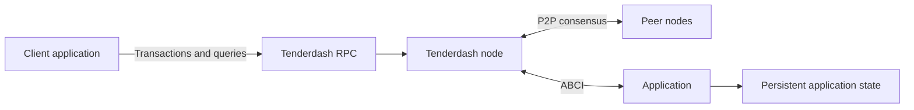

# Application Architecture Guide

A Tenderdash deployment separates the consensus node from the application that
defines transaction rules and owns application state. A client submits
transactions or queries through an RPC or application API.

Tenderdash orders transactions and agrees on blocks. The ABCI application
validates transactions with `CheckTx`, prepares and validates proposals with
`PrepareProposal` and `ProcessProposal`, and finalizes decided blocks with
`FinalizeBlock`. Queries use `Query`; the application defines the query format
and any proofs it returns.

The application must produce deterministic results for the same consensus
input. Keep replicated state changes inside the ABCI lifecycle. External
services may provide read APIs, but must not independently mutate that state.

An application written in Go can run in the same process as Tenderdash using a
local ABCI client. Other deployments can run the application as a separate
process through an ABCI socket or gRPC connection. Protect these connections:
ABCI is a trusted interface, not a public client endpoint. Restrict network
access and provide authentication and encryption when crossing a network boundary.

Client applications can broadcast transactions using the `/broadcast_tx_*` RPC
methods and query through `/abci_query`. A successful broadcast does not by itself
prove that a transaction was committed successfully. Inspect committed results
and verify application proofs according to the application's security model.

See the [RPC guide](../tenderdash-core/rpc.md),
[ABCI specification](../../spec/abci/README.md),
[Go tutorials](../tutorials/readme.md) and
[production operations guide](../nodes/running-in-production.md).
