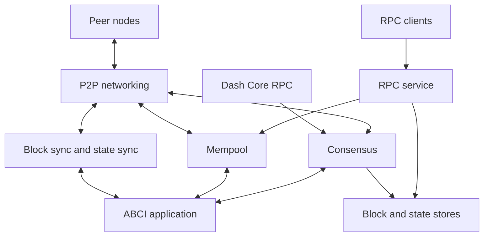

# Tenderdash Architectural Overview

A Tenderdash node combines peer networking, consensus, transaction admission,
block storage and an ABCI connection to the application. The
[`node` package](https://github.com/dashpay/tenderdash/tree/master/node)
constructs these services and manages their lifecycle.

## Communication

- **Peer communication:** long-lived P2P connections exchange transactions,
  blocks, votes, evidence and state-sync messages.
- **Application communication:** ABCI requests validate transactions, prepare and
  process proposals, finalize blocks and query application state. The application
  can run in the same Go process or through an external ABCI connection.
- **Client communication:** the RPC service accepts transactions, answers queries
  and exposes events and node status. RPC access is separate from P2P networking.
- **Dash Core communication:** quorum and ChainLock information connects Platform
  consensus to Dash Core. Configure the appropriate Core RPC endpoint for your network.

## Reactors and P2P services

P2P services handle distinct message types: consensus votes and proposals,
transaction gossip, block synchronization, evidence, peer exchange and state
synchronization. Multiplexed channels share peer connections while separating
these message flows. See the [P2P specification](../../spec/p2p/readme.md)
for the transport and wire protocol.

Block sync brings a node up to date by downloading and verifying blocks.
State sync restores an application snapshot and the consensus state needed to
resume processing. When caught up, a node participates in live consensus.
See [block sync](../tenderdash-core/block-sync/README.md) and
[state sync](../nodes/state-sync.md).

## Node roles

A **validator** holds consensus signing keys and votes when it belongs to the
active validator set. A **full node** verifies and stores blocks without voting.
A **seed node** helps other nodes discover peers. The role is configured by
`mode` in `config.toml`; see [configuration](../nodes/configuration.md).

For the detailed consensus rules, read the
[consensus specification](../../spec/consensus/consensus.md).
