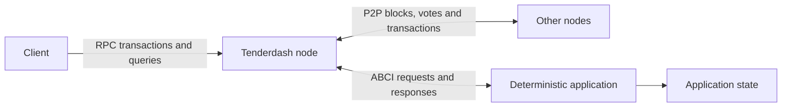

# What is Tenderdash

Tenderdash is the consensus engine used by Dash Platform. It replicates an
application across a network of validators, ordering transactions into blocks
and agreeing on application state. The application implements the Application
BlockChain Interface (ABCI); Tenderdash handles peer communication, transaction
gossip and Byzantine fault tolerant consensus.

## Consensus and validators

Validators take turns proposing blocks at each height. They vote in two stages,
**prevote** and **precommit**. To commit a block, precommits for it in the same
round must reach the configured voting threshold, and quorum threshold-signature
recovery and verification must succeed. The voting threshold can be an explicit
override or the Dash quorum-type default; changing it does not lower the
quorum's signature-recovery threshold. If a round cannot commit a block,
validators move to another round with a new proposer.

The usual BFT safety argument assumes less than one-third of voting power is
Byzantine and a voting threshold strictly above two-thirds. Tenderdash accepts
some lower thresholds, so that safety bound is not guaranteed by configuration.
See the [threshold definitions](../../spec/consensus/consensus.md#terminology),
[system-model assumptions](../../spec/consensus/consensus.md#system-model-as-enforced-by-the-code)
and [threshold recovery](../../spec/consensus/consensus.md#threshold-recovery).
Safety also depends on correct key management, validation and locking rules. Progress
requires enough validators to communicate and sufficiently timely message
delivery; a network partition can halt block production.

Tenderdash uses BLS validator keys and quorum information from Dash Core.
Dash Core ChainLocks and quorum verification connect Platform consensus to
Dash's security model. See the [protocol specification](../../spec/README.md),
[validator guide](../nodes/validators.md) and
[consensus specification](../../spec/consensus/consensus.md) for details.

## Application boundary

An ABCI application defines transaction validity, execution and state storage.
Tenderdash treats transaction contents as application-defined bytes.

Important application calls include:

- `CheckTx` checks transactions before admission to the mempool.
- `PrepareProposal` lets the proposer application select and prepare transactions.
- `ProcessProposal` lets validator applications validate a proposed block.
- `ExtendVote` and `VerifyVoteExtension` support application-defined vote extensions.
- `FinalizeBlock` delivers a decided block and persists the resulting application state.
- `Info`, `InitChain` and `Query` support startup, initialization and queries.
- Snapshot methods support [state sync](../nodes/state-sync.md).

The [Go application interface](../../abci/types/application.go)
and [ABCI specification](../../spec/abci/README.md) define the contract.
Use the interface and specification from the same release as your node.

## Determinism

Every correct validator must compute the same results for the same committed
input. Application execution must avoid uncontrolled sources of nondeterminism,
including local clocks, unseeded randomness, concurrent access to mutable state,
unordered map iteration and platform-dependent floating point behavior.

Application state changes must follow the consensus lifecycle. An application
must not let unrelated external writes alter the replicated state.

## Start building

[Install Tenderdash](./install.md), follow the [quick start](./quick-start.md),
and explore the [application development guide](../app-dev/getting-started.md).
The [architecture overview](./architecture.md) explains the node's components.
