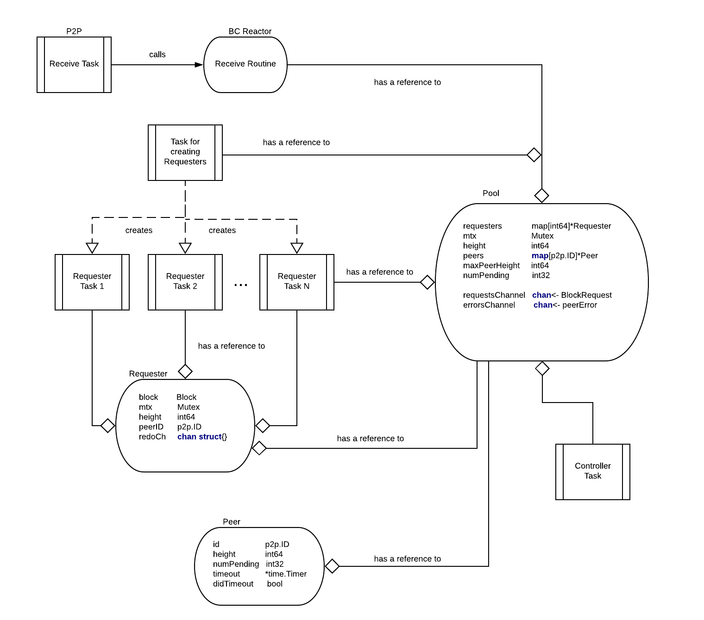

# Reactor

The Blocksync Reactor's high level responsibility is to enable peers who are
far behind the current state of the consensus to quickly catch up by downloading
many blocks in parallel, verifying their commits, and executing them against the
ABCI application.

Tenderdash full nodes run the Blocksync Reactor as a service to provide blocks
to new nodes. New nodes run the Blocksync Reactor in "fast_sync" mode,
where they actively make requests for more blocks until they sync up.
Once caught up, "fast_sync" mode is disabled and the node switches to
using (and turns on) the Consensus Reactor.

## Architecture and algorithm

The pseudocode below describes the historical requester-based implementation.
The current synchronizer in `internal/blocksync` uses a worker pool. Five
consecutive failed requests remove a peer; a successful response resets that
failure count. The client request timeout remains 60 seconds.

Scheduling also accounts for useful service while requests are outstanding:

- Active waiting begins after the client admits a request and ends at its first
  correlated response, timeout, or cancellation. Overlapping requests consume
  time once, not once per request. Worker queues before admission, completed
  result buffering, block application, and idle intervals do not consume time.
- A response earns one second plus its encoded bytes divided by 128 KiB/s only
  after conversion, basic validation, and the requested-height check. Commit
  verification and application retain their existing later checks. Saved credit
  is limited to ten seconds, so an old burst cannot hide sustained poor service.
- More than ten seconds of service debt reduces future assignments. Existing
  requests drain; after a thirty-second cooldown, one recovery request is allowed.
  Due recovery requests receive a turn even when other peers are healthy. Two
  consecutive recovery responses meeting the size-adjusted allowance restore
  ordinary pipelining. Slow or failed probes restart the cooldown.

These are soft scheduling allowances, not measured wire bandwidth or a guaranteed
minimum connection speed. They let prompt tiny blocks earn progress through their
count and larger blocks through their bytes. There is no partial-byte telemetry:
a large unanswered response can provisionally reduce preference, and its validated
bytes can correct that estimate on completion. Local transport and router queues
between client admission and resolution remain included in the observation.

A scheduling penalty never disconnects a peer or makes its advertised block range
unavailable. A sole source remains eligible for bounded recovery attempts, which
prevents a false no-source handoff to consensus. Status refreshes preserve service
history; a removed and re-added peer starts fresh. The twenty pending requests per
peer, sixty-four outstanding heights, completed-backlog byte budget, validation,
and hard failure policy are unchanged. The 60-second request deadline can still
reject a large response on a slow connection even if its eventual service rate
would meet the scheduling allowance.

Block sync hands over to consensus when it reaches the highest height any peer
claims; when no peer advertises the next height and no block has been applied
for 60 seconds; when the node has been at the tip of the chain for two minutes;
or when no block has been applied for 10 minutes and the node is within 10
blocks of every claim that covers the next height and comes from a peer that
has backed it. When the node's last block was more than a day old as the stall
began, that last rule counts every claim that covers the next height, backed or
not, so a node far behind keeps syncing while its peers fail requests and
resumes as soon as one serves again.

Whether the node is at the tip is judged from the time of its last applied
block, which the validators commit to and a peer cannot change: a node behind
the network applies old blocks. The node is at the tip while that block is no
older than the chain took to commit its last 10 blocks, or than 70 seconds
where that is longer, and in any case no older than five minutes. Seventy
seconds is the 60-second stall after which a node with nothing to fetch hands
over plus a status round, so a pause in block production ends block sync by
one rule or the other. The pace of the chain is taken from the blocks in the
block store at start and from those applied since; with no earlier block
stored, only the five-minute limit applies until a block is applied. Five
minutes covers the three-minute empty-block interval Dash Platform runs with
and a margin for extra rounds and clock skew. A block time further ahead of the
local clock than the synchrony precision does not count. Peer height claims
play no part in this rule. Whenever a node at the tip hands over, the
consensus catch-up target is the highest claim seen within 10 blocks of it.

A peer backs its claim by supplying a block the node applies, and loses that
credit when it fails a request (a timeout or other failure, or a
`NoBlockResponse`) or is dropped; a newly connected peer has none. Block
requests go to peers that have backed their claims first. The next block is
asked of every other peer that advertises it once a request for it times out
or fails otherwise, once every peer asked for it is on probation for holding
requests too long, or once 10 seconds pass without it, counted from its latest
request or from when it became the next block, whichever is later. A peer
answering that it has no such block has it asked of one other peer instead.

What operators can expect:

- A node that has reached the tip hands over two minutes later, whatever
  heights peers claim, as long as it applies each new block before the one
  before it is older than the at-tip window: within about two minutes of its
  commit on a chain committing a block every three minutes, and within about
  a minute on a chain committing one every few seconds. A single slow peer
  delays a block by up to about 10 seconds.
- On a chain that has stopped producing blocks, a restarted node hands over
  after 10 minutes without a block, or once every peer that supplied blocks
  earlier has failed a request for the next one, whichever is later. If the
  chain had been stopped for more than a day when the node started waiting,
  the node keeps waiting while a peer claims a height more than 10 blocks
  above it and advertises the next block.
- A node may hand over a few blocks behind the network, up to about 70
  seconds of blocks on a fast chain, or up to five minutes of blocks after a
  restart with no earlier block stored; consensus catch-up closes the rest.
- A node whose clock runs ahead of the validators' by more than its at-tip
  window, or behind them by more than the synchrony precision, does not see
  itself at the tip and leaves block sync only by the other rules. Keep the
  clock synchronised.
- After a handover on a stall away from the tip, the node may hold back its
  own proposals for up to 10 minutes while consensus catches up.
- A node that stays in block sync while its blocks are recent, or hands over
  far behind, is worth reporting with its logs: a handover below the highest
  peer claim is logged at warning or error level with its reason.

The historical Blocksync reactor is organised as a set of concurrent tasks:

- Receive routine of Blocksync Reactor
- Task for creating Requesters
- Set of Requesters tasks and - Controller task.



### Data structures

These are the core data structures necessarily to provide the Blocksync Reactor logic.

Requester data structure is used to track assignment of request for `block` at position `height` to a peer with id equals to `peerID`.

```go
type Requester {
  mtx          Mutex
  block        Block
  height       int64
  peerID       p2p.ID
  redoChannel  chan p2p.ID //redo may send multi-time; peerId is used to identify repeat
}
```

Pool is a core data structure that stores last executed block (`height`), assignment of requests to peers (`requesters`), current height for each peer and number of pending requests for each peer (`peers`), maximum peer height, etc.

```go
type Pool {
  mtx                Mutex
  requesters         map[int64]*Requester
  height             int64
  peers              map[p2p.ID]*Peer
  maxPeerHeight      int64
  numPending         int32
  store              BlockStore
  requestsChannel    chan<- BlockRequest
  errorsChannel      chan<- peerError
}
```

Peer data structure stores for each peer current `height` and number of pending requests sent to the peer (`numPending`), etc.

```go
type Peer struct {
  id           p2p.ID
  height       int64
  numPending   int32
  timeout      *time.Timer
  didTimeout   bool
}
```

BlockRequest is internal data structure used to denote current mapping of request for a block at some `height` to a peer (`PeerID`).

```go
type BlockRequest {
  Height int64
  PeerID p2p.ID
}
```

### Receive routine of Blocksync Reactor

It is executed upon message reception on the BlocksyncChannel inside p2p receive routine. There is a separate p2p receive routine (and therefore receive routine of the Blocksync Reactor) executed for each peer. Note that try to send will not block (returns immediately) if outgoing buffer is full.

```go
handleMsg(pool, m):
    upon receiving bcBlockRequestMessage m from peer p:
      block = load block for height m.Height from pool.store
      if block != nil then
        try to send BlockResponseMessage(block) to p
      else
        try to send bcNoBlockResponseMessage(m.Height) to p

    upon receiving bcBlockResponseMessage m from peer p:
      pool.mtx.Lock()
      requester = pool.requesters[m.Height]
      if requester == nil then
        error("peer sent us a block we didn't expect")
        continue

      if requester.block == nil and requester.peerID == p then
        requester.block = m
        pool.numPending -= 1  // atomic decrement
        peer = pool.peers[p]
        if peer != nil then
          peer.numPending--
          if peer.numPending == 0 then
            peer.timeout.Stop()
            // NOTE: we don't send Quit signal to the corresponding requester task!
        else
          trigger peer timeout to expire after peerTimeout
      pool.mtx.Unlock()


    upon receiving bcStatusRequestMessage m from peer p:
      try to send bcStatusResponseMessage(pool.store.Height)

    upon receiving bcStatusResponseMessage m from peer p:
      pool.mtx.Lock()
      peer = pool.peers[p]
      if peer != nil then
        peer.height = m.height
      else
        peer = create new Peer data structure with id = p and height = m.Height
        pool.peers[p] = peer

      if m.Height > pool.maxPeerHeight then
        pool.maxPeerHeight = m.Height
      pool.mtx.Unlock()

onTimeout(p):
  send error message to pool error channel
  peer = pool.peers[p]
  peer.didTimeout = true
```

### Requester tasks

Requester task is responsible for fetching a single block at position `height`.

```go
fetchBlock(height, pool):
  while true do {
    peerID = nil
    block = nil
    peer = pickAvailablePeer(height)
    peerID = peer.id

    enqueue BlockRequest(height, peerID) to pool.requestsChannel
    redo = false
    while !redo do
      select {
        upon receiving Quit message do
          return
        upon receiving redo message with id on redoChannel do
          if peerID == id {
            mtx.Lock()
            pool.numPending++
            redo = true
            mtx.UnLock()
          }
      }
    }

pickAvailablePeer(height):
  selectedPeer = nil
  while selectedPeer = nil do
    pool.mtx.Lock()
    for each peer in pool.peers do
      if !peer.didTimeout and peer.numPending < maxPendingRequestsPerPeer and peer.height >= height then
        peer.numPending++
        selectedPeer = peer
        break
    pool.mtx.Unlock()

    if selectedPeer = nil then
      sleep requestIntervalMS

  return selectedPeer
```

sleep for requestIntervalMS

### Task for creating Requesters

This task is responsible for continuously creating and starting Requester tasks.

```go
createRequesters(pool):
  while true do
    if !pool.isRunning then break
    if pool.numPending < maxPendingRequests or size(pool.requesters) < maxTotalRequesters then
      pool.mtx.Lock()
      nextHeight = pool.height + size(pool.requesters)
      requester = create new requester for height nextHeight
      pool.requesters[nextHeight] = requester
      pool.numPending += 1 // atomic increment
      start requester task
      pool.mtx.Unlock()
    else
      sleep requestIntervalMS
      pool.mtx.Lock()
      for each peer in pool.peers do
        if !peer.didTimeout && peer.numPending > 0 && peer.curRate < minRecvRate then
          send error on pool error channel
          peer.didTimeout = true
        if peer.didTimeout then
          for each requester in pool.requesters do
            if requester.getPeerID() == peer then
              enqueue msg on requestor's redoChannel
          delete(pool.peers, peerID)
      pool.mtx.Unlock()
```

### Main blocksync reactor controller task

```go
main(pool):
  create trySyncTicker with interval trySyncIntervalMS
  create statusUpdateTicker with interval statusUpdateIntervalSeconds
  create switchToConsensusTicker with interval switchToConsensusIntervalSeconds

  while true do
    select {
   upon receiving BlockRequest(Height, Peer) on pool.requestsChannel:
     try to send bcBlockRequestMessage(Height) to Peer

   upon receiving error(peer) on errorsChannel:
     stop peer for error

   upon receiving message on statusUpdateTickerChannel:
     broadcast bcStatusRequestMessage(bcR.store.Height) // message sent in a separate routine

   upon receiving message on switchToConsensusTickerChannel:
     pool.mtx.Lock()
     receivedBlockOrTimedOut = pool.height > 0 || (time.Now() - pool.startTime) > 5 Seconds
     ourChainIsLongestAmongPeers = pool.maxPeerHeight == 0 || pool.height >= pool.maxPeerHeight
     haveSomePeers = size of pool.peers > 0
     pool.mtx.Unlock()
     if haveSomePeers && receivedBlockOrTimedOut && ourChainIsLongestAmongPeers then
       switch to consensus mode

          upon receiving message on trySyncTickerChannel:
            for i = 0; i < 10; i++ do
              pool.mtx.Lock()
              firstBlock = pool.requesters[pool.height].block
              secondBlock = pool.requesters[pool.height].block
              if firstBlock == nil or secondBlock == nil then continue
              pool.mtx.Unlock()
              verify firstBlock using LastCommit from secondBlock
              if verification failed
                pool.mtx.Lock()
                peerID = pool.requesters[pool.height].peerID
                redoRequestsForPeer(peerId)
                delete(pool.peers, peerID)
                stop peer peerID for error
                pool.mtx.Unlock()
              else
                delete(pool.requesters, pool.height)
                save firstBlock to store
                pool.height++
                execute firstBlock
    }

redoRequestsForPeer(pool, peerId):
  for each requester in pool.requesters do
    if requester.getPeerID() == peerID
     enqueue msg on redoChannel for requester
```

## Channels

Defines `maxMsgSize` for the maximum size of incoming messages,
`SendQueueCapacity` and `RecvBufferCapacity` for maximum sending and
receiving buffers respectively. These are supposed to prevent amplification
attacks by setting up the upper limit on how much data we can receive & send to
a peer.

Sending incorrectly encoded data will result in stopping the peer.
