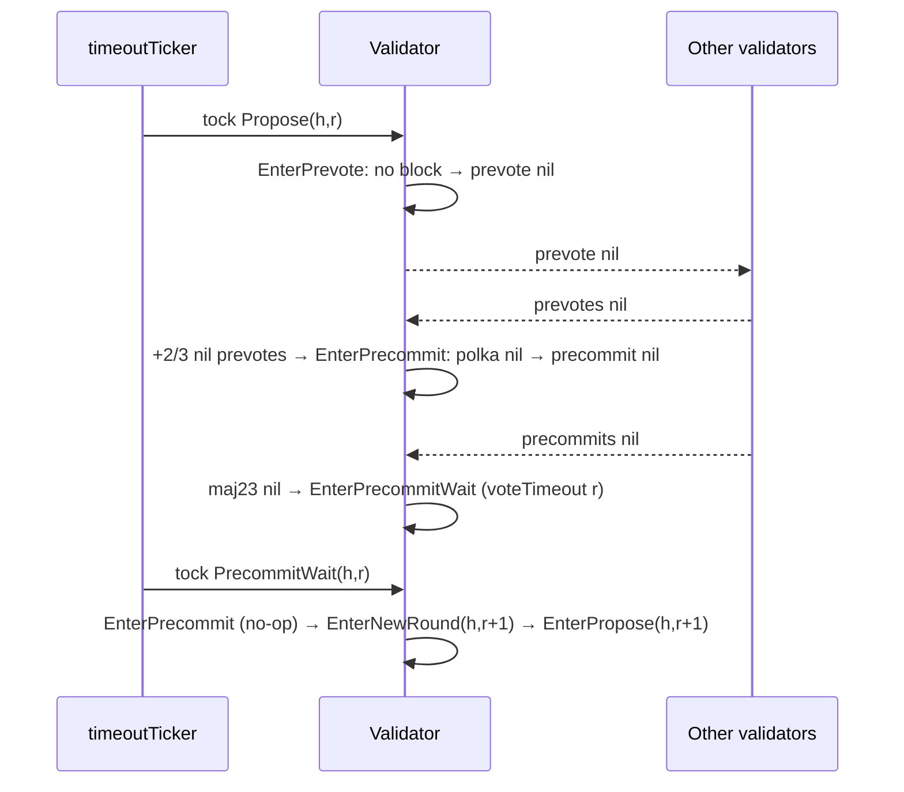

# Alternative flows and edge cases

Each section states the situation, the behaviour the code implements, and the
implementing function. Commit-related flows are in
[Commit handling](./consensus-commit.md); crash recovery and sync handover in
[Recovery and synchronisation](./consensus-recovery.md).

## Proposal missing, late or invalid

### Proposer silent or slow

`timeoutPropose` (`proposeTimeout(r)`) fires → `EnterPrevote`.
`isValidForPrevote` fails with `errPrevoteProposalBlockNil` → **nil prevote**,
no ABCI call (`prevoter.Do`). When every validator prevotes nil, the +2/3
nil majority dispatches `EnterPrecommit` directly — no `PrevoteWait`, no
`voteTimeout(r)` (`addVoteDispatchPrevoteMw`: `TwoThirdsMajority()` returns
the nil block id, and `blockID.IsNil()` satisfies the precommit condition) →
nil precommit → +2/3 nil precommits → `EnterPrecommitWait` → `voteTimeout(r)`
→ `EnterNewRound(r + 1)`. `EnterPrevoteWait` is reached only when the
prevotes hold +2/3-any **without** a majority (some validators did receive
and prevote the block), in which case `voteTimeout(r)` precedes
`EnterPrecommit`.

### Proposal arrives after the node prevoted

`Proposaler.Set` has no step check, so the proposal is still stored and parts
are still collected. `ProposalCompletedAction.Execute` enters prevote only
while `step ≤ Propose`, so the node does not prevote it. The block can still:

- become `ValidBlock` if a polka for it exists or forms
  (`ProposalCompletedAction.Execute`, `addVoteUpdateValidBlockMw`);
- be precommitted if a polka for it forms while the node is in `Prevote`
  (`addVoteDispatchPrevoteMw` → `EnterPrecommit`; rule C-Lock);
- be re-proposed in a later round as `ValidBlock`.

### Proposal for another height or round

Ignored silently (`Proposaler.Set`). Block parts for another **round** of the
current height are accepted into the current part set when their proofs match
its header ("blocks might be reused", `addProposalBlockPart`); parts for
another height are ignored; parts when no part set is expected are ignored.
`blockPartMessageHandler` swallows errors for parts whose round differs from
the current one.

### Invalid `POLRound`, bad signature, wrong proposer

`ErrInvalidProposalPOLRound`, `ErrInvalidProposalSignature` (counted in
`ProposalVerifyFailures`), see
[Proposal acceptance](./consensus-transitions.md#proposal-acceptance-proposalerset).
A proposal signed by a validator other than `proposer(h, r)` fails the
signature check because the signature is verified against the expected
proposer's key only. The round proceeds as if no proposal had been received.

### Proposal contradicts the round's target block

Refused with `ErrInvalidProposalForCommit` (a verified commit for the same
`(h, r)` names another block), `ErrInvalidProposalForPartSet` (a part set is
already being collected under another header), or `ErrInvalidProposalBlockID`
/ `ErrInvalidProposalCoreHeight` (a block is already assembled and differs)
(`roundStateRefusal`, `Proposaler.Set`). Rationale: a part-set header is a
Merkle root over exactly one block's bytes, so a disagreeing proposal could
never be acted on and would make the node reject the parts it is waiting for.

### Block id mismatch discovered when the block completes

If the assembled block's hash or part-set header differ from the proposal's,
the proposal is dropped (`rs.Proposal = nil`) but the block is kept
(`addProposalBlockPart`). The node later prevotes nil
(`errPrevoteProposalNil`). The fields not covered by the proposal signature
(`CoreChainLockedHeight`, `BlockID.StateID`) are instead taken from the
authenticated block bytes.

### Oversized or malformed block

Accumulated parts above `ConsensusParams.Block.MaxBytes` → error; an
undecodable block → error (`addProposalBlockPart`). Parts with invalid Merkle
proofs are charged to the sender's `blockPartProofBudget` and dropped
silently once it is exhausted (`internal/consensus/block_part_budget.go`).

### Application rejects the block, or the header does not match

`ProcessProposal` returning `REJECT` (`sm.ErrBlockRejected`), or a
well-formed `ACCEPT` whose contents disagree with the block — header
mismatch / invalid `LastCommit` / invalid chain lock (`sm.ErrInvalidBlock`)
— → nil prevote (`prevoter.handleError`). A failed `ProcessProposal` clears
`CurrentRoundState`, so no round counts as processed until a later call
succeeds (`blockExecutor.ensureProcess`). Any **other** error **panics**
the node: transport failure, `UNKNOWN` status, or a malformed response — an
`AppHash` of the wrong size fails `ResponseProcessProposal.Validate` and
`tx_results` not matching the transactions fails `validateExecTxResults`,
both returned by `BlockExecutor.ProcessProposal` as plain errors, not as
`ErrInvalidBlock`. The same block
reaching `EnterPrecommit` via a polka would call `mustEnsureProcess`, which
panics on failure — a node that could not process a block cannot have a
polka-matching proposal block for it unless the application is
non-deterministic.

During WAL replay a mismatch between a stored block's `AppHash` and the
application's result stops the node (`checkAppHashEqualsOneFromBlock` in
`internal/consensus/replayer.go`).

### Proposal timestamp differs from block time

Nil prevote (`errPrevoteTimestampNotEqual`) and nil precommit
(rule C-Timestamp).

## Locking

The lock is defined by `LockedRound/LockedBlock` and the rules
[P-Lock-NoPOL, P-Lock-POL](./consensus-transitions.md#prevote-decision-prevoterdo)
and [C-Lock, C-Relock, C-LockedNotProposed](./consensus-transitions.md#precommit-decision-enterprecommitactionexecute).

| Situation | Behaviour | Evidence |
| ----------- | ----------- | ---------- |
| Locked on `B` at `r`; round `r + k` proposes `B` with `POLRound ≥ LockedRound` or without POL | Prevote `B` (lock match) | `prevoter.checkProposalBlock`, `checkPrevoteMaj23`; `TestStateLock_POLRelock` |
| Locked on `B`; round `r + k` proposes `C ≠ B` with `POLRound = -1` | Prevote nil (`ProcessProposal` still runs for `C`) | `TestStateLock_PrevoteNilWhenLockedAndDifferentProposal` |
| Locked on `B`; proposal `C` with `POLRound = p ≥ LockedRound` and a polka for `C` at `p` | Prevote `C`; if a polka for `C` forms this round → lock moves to `C` (`updateLockedBlock`) | `TestStateLock_POLUpdateLock` |
| Locked on `B`; proposal `C` with `POLRound = p < LockedRound` | Prevote nil | `checkPrevoteMaj23` |
| Polka for nil in a later round | Lock unchanged — **no unlock** | `TestStateLock_POLDoesNotUnlock` |
| Polka for `B` (the locked block) in round `r + k` but no proposal for `B` in that round | Precommit nil, lock unchanged | rule C-LockedNotProposed; `TestStateLock_MissingProposalWhenPOLSeenDoesNotUpdateLock` |
| Polka for `B` in round `r + k` and proposal for `B` | Relock: `LockedRound = r + k`, precommit `B` after re-processing for `r + k` | `TestStateLock_POLRelock` |
| Proposal for an old block (`POLRound` pointing at a polka for another block) | Not prevoted, not locked | `TestStateLock_DoesNotLockOnOldProposal` |

Liveness consequence of C-LockedNotProposed: when a round's proposer is slow
or faulty, validators locked on `B` do not relock even if the other
validators prevote `B`; the network must wait for a later proposer to
re-propose `B` with `POLRound` set.

## Valid-block bookkeeping

`StateData.updateValidBlock` sets `ValidRound = Round`, and when the block
differs from the current `ValidBlock`, `ValidBlock = ProposalBlock`,
`ValidBlockParts`, and `ValidBlockRecvTime` = `ProposalReceiveTime` when the
proposal names this block, else `now`. It is called from:

1. `addVoteUpdateValidBlockMw`: a prevote completes a polka for non-nil `B`
   in the **current** round with `ValidRound < Round`, and the node holds `B`.
   Whether or not it holds `B`, `retargetTo(B, polka)` then drops a proposal
   for another block, replaces the part set unless its header is `B`'s, and a
   `ValidBlock` event is published so peers send `B`'s parts
   (`NewValidBlockMessage`).
2. `ProposalCompletedAction.Execute`: the block completes while a polka for
   it already exists in the current round.
3. `EnterPrecommitAction.Execute`: after a first lock.

`ValidRound/ValidBlock` are never reset within a height and survive
`EnterNewRound`.

**Re-proposal.** `Proposaler.Create` reuses `ValidBlock` iff
`checkValidBlock`: at `InitialHeight` its time equals the genesis time;
otherwise `ValidBlock.IsTimely(ValidBlockRecvTime, SynchronyParams, ValidRound)`.
A re-proposal keeps the original header (proposer, time) and carries
`POLRound = ValidRound`. Receivers skip the timeliness check for a block that
is their own `ValidBlock` (`isValidForPrevote`) and skip the proposer check
when `POLRound ≥ 0`. When `ValidBlock` is **not** timely a fresh block is
built and proposed with `POLRound = -1`, so receivers judge it like any new
proposal (timeliness, proposer check, rule P-Lock-NoPOL). A validator locked
on another block prevotes nil for it; see
[Known issues](./consensus-known-issues.md#an-untimely-validblock-is-never-re-proposed).

## Round skipping and nil rounds

- **Future-round prevotes.** `+2/3`-any prevotes at `vote.Round > r` →
  `EnterNewRound(vote.Round)` (`addVoteDispatchPrevoteMw`). The node skips
  the intermediate rounds without voting in them.
- **Future-round precommits.** `+2/3`-any precommits without a majority at
  `vote.Round ≥ r` → `EnterNewRound(vote.Round)` + `EnterPrecommitWait`
  (`addVoteDispatchPrecommitMw`); the node then waits `voteTimeout` before
  `r + 1`. A precommit majority for a block at **any** round (including a
  round below the current one) → `EnterCommit` with that round
  (`TestCommitFromPreviousRound`).
- **Future-round commit.** A verified `CommitMessage` for `commit.Round > r`
  → `EnterNewRound(commit.Round)` then application
  ([Commit handling](./consensus-commit.md#commit-for-a-later-round)).
- **Round bookkeeping.** `HeightVoteSet` keeps vote sets for rounds
  `0 .. Round + 1` (`SetRound(round + 1)` in `EnterNewRoundAction`) plus at
  most two "catch-up" rounds per validator pro-tx-hash
  (`HeightVoteSet.addVote`, `ErrGotVoteFromUnwantedRound`). Vote sets are
  never released within a height.
- **All-nil round.** Nil polka → nil precommit → nil precommit majority →
  `EnterPrecommitWait` — the node still waits `voteTimeout(r)` even though
  the round is decided — → `EnterNewRound(r + 1)`.
- **Idempotence.** `TriggeredTimeoutPrecommit` makes `EnterPrecommitWait`
  run once per round; the step guards do the same for the other actions.
- **What survives a round change.** `LockedBlock`, `ValidBlock`, parked
  `Commit`, and all vote sets; `Proposal` and the proposal block/parts are
  cleared unless a commit is parked (`EnterNewRoundAction.Execute`).

## Equivocation, duplicates and conflicting votes

Implemented in `VoteSet.addVote` / `addVerifiedVote` (`types/vote_set.go`)
and `addVoteErrorMw` (`internal/consensus/state_add_vote.go`).

- Identical vote (same validator, block key and block signature): not added,
  no error.
- Same validator and block key, different signature:
  `ErrVoteNonDeterministicSignature` (BLS signatures are deterministic;
  logged at error level).
- Same validator, different block id: the second vote is recorded only in
  `votesByBlock` when some peer claimed +2/3 for that block id
  (`peerMaj23`, set by `VoteSetMaj23Message` → `VoteSet.SetPeerMaj23`); it
  replaces the first in `votes` only if it matches `maj23`. The pair is
  returned as `ErrVoteConflictingVotes` and reported to the evidence pool
  (`evidencePool.ReportConflictingVotes`) unless the key is the node's own
  (logged: "did you unsafe_reset a validator?") or no private validator is
  set (`ErrPrivValidatorNotSet`). The evidence pool stores it unverified;
  it reaches the application as `Misbehavior` only if a proposer includes it
  (`evpool.PendingEvidence` in `CreateProposalBlock`).
- Conflicting **proposals** by the same proposer: the first valid one is
  kept and the second ignored while the first occupies `rs.Proposal`; a
  current-round polka or a commit for the second block drops the first
  (`StateData.retargetTo` → `dropStaleProposal`) and the second is then
  accepted ([invariant 5](./consensus.md#invariants)). No evidence is
  produced.

## Vote extensions

- The node asks ABCI `ExtendVote` only when signing a **non-nil precommit**
  (`voteSigner.signVote`). The response must parse
  (`NewVoteExtensionsFromABCIExtended`); otherwise the node panics.
- Supported extension types (`types/vote_extension.go`):
  `THRESHOLD_RECOVER` and `THRESHOLD_RECOVER_RAW` (threshold-recoverable;
  `RAW` may carry an application-supplied sign request id that binds no
  height or round). `DEFAULT` exists in the enum but is **not supported**:
  `NewVoteExtensionsFromABCIExtended` rejects it in an `ExtendVote` response
  (`ErrUnsupportedVoteExtensionType`), and `VoteExtension.Validate`
  (`proto/tendermint/types/dash.go`) rejects it in a peer's vote
  (`Vote.ValidateBasic`).
  A prevote or nil precommit carrying extensions fails `Vote.ValidateBasic`.
- Each peer precommit's extension signatures are verified after the block
  signature (`types.VerifyVoteSignatures`), then ABCI `VerifyVoteExtension`
  is called with the validator's pro-tx-hash. A rejected vote is not stored
  (`addVoteVerifyVoteExtensionMw`). Own votes skip the ABCI call.
- At most `MaxVoteExtensions = 32` extensions are accepted on verification
  paths (`types/quorum_sign_data.go`); the signing path is not capped.
- The commit carries only the threshold-recovered extensions of the
  canonical group ([Threshold recovery](./consensus.md#threshold-recovery)).
  Before a block is saved the application sees them once more as a single
  `VerifyVoteExtension` with an empty `ValidatorProTxHash`
  (`sm.VerifyCommitExtensions`).

## Proposal timestamps and time rules

- The proposer sets `Header.Time = now` (genesis time at `InitialHeight`,
  `State.makeBlockTime`). Before proposing, a proposer whose clock is behind
  `state.LastBlockTime` waits for the difference
  (`EnterProposeAction.Execute`, `proposerWaitTime`).
- Validity: `Time > state.LastBlockTime` for `h > InitialHeight`,
  `Time ≥ genesis` at `InitialHeight` (`validateBlock`).
- Timeliness is checked **only at prevote time**, against the proposal's
  receive time (`ProposalReceiveTime` = enqueue time of the
  `ProposalMessage`, `chanMsgSender.send`), with the window of
  `checkTimely` (rule P-Timely). It is skipped in replay mode and for a
  block that is the node's `ValidBlock`, so re-proposals of an already
  polka'd block are not re-judged.
- Timeliness governs re-proposal (`Proposaler.checkValidBlock`).
- Metric `ProposalTimestampDifference{is_timely}` is recorded for proposals
  with `POLRound = -1` (`Proposaler.proposalTimestampDifferenceMetric`).

## Mempool and empty blocks

`EnterNewRoundAction.Execute` waits for transactions when
`WaitForTxs() = ¬CreateEmptyBlocks ∨ CreateEmptyBlocksInterval > 0`, at
round 0, above `InitialHeight`, unless `ProposeNextBlockImmediately`
(set from `ResponseFinalizeBlock.propose_next_block_immediately` of the
previous height by `ApplyCommitAction.Execute`; consumed by the next
`updateToState`; not persisted, so a restart falls back to the configured
wait).

`State.handleTxsAvailable` acts only at round 0: at step `NewHeight` (and
not at `InitialHeight`) it schedules a `NewRound` tock for
`StartTime − now + 1 ms`; at step `NewRound` it dispatches `EnterPropose`.
With `CreateEmptyBlocksInterval > 0` the interval tock calls `EnterPropose`
even without transactions (empty block). Rounds `≥ 1` never wait.

## Validator-set and parameter changes

- Changes come from the application's `ValidatorSetUpdate` in the
  `PrepareProposal`/`ProcessProposal` response and are reflected in the
  header's `NextValidatorsHash`, which every validator checks against its own
  application's answer (`ValidateBlockWithRoundState`). With an unchanged
  `QuorumHash` the update is applied as a change set; with a new
  `QuorumHash` the new set replaces the old one
  (`CurrentRoundState.valsetUpdate` in `internal/state/current_round_state.go`).
- `State.Update` makes `Validators ← NextValidators`,
  `LastValidators ← Validators`; the new set votes from height `h + 1`
  (`updateToState` builds the next `HeightVoteSet` from it and logs
  "Updating validators" when the quorum hash or threshold changes).
- Consensus parameters (timeouts, synchrony, block limits, proposer-selection
  version) proposed in block `h` take effect at `h + 1`
  (`LastHeightConsensusParamsChanged`).
- Proposer selection version is `ConsensusParams.Version.ConsensusVersion`
  ([Proposer selection](./proposer-selection.md)).

## Core chain locks

- Header fields: `CoreChainLockedHeight`; optional `CoreChainLock` in the
  block (and `CoreChainLockUpdate` in the proposal, not signed).
- `ValidateBlockChainLock` (prevote) and `validateCoreChainLock`
  (`ValidateBlockWithRoundState`): with a lock, the header height equals the
  lock's and exceeds `state.LastCoreChainLockedBlockHeight`; without one, it
  equals it.
- `Proposaler.Set` rejects `proposal.CoreChainLockedHeight` below the
  committed height; after the block completes the proposal's value is
  overwritten from the block.
- `state.LastCoreChainLockedBlockHeight` advances only when the block
  carries a `CoreChainLock` (`CurrentRoundState.UpdateState`).

## Non-validators and signer problems

- **Observers** (node not in `Validators`): the reactor drops incoming
  `Vote` messages (`Reactor.handleVoteMessage`); the consensus state still
  runs `Enter*` actions on timeouts, but `voteSigner.signAddVote` returns
  without signing (`!Validators.HasProTxHash(own)`). Observers progress to
  the next height only through `CommitMessage`s and block parts
  ([Commit handling](./consensus-commit.md#commits-received-from-peers)).
  Peers gossip proposals, votes and `VoteSetMaj23` only to validator peers,
  and block parts to non-validators once they announce a commit
  (`gossip_handlers.go`).
- **No private validator** (`privValidator.IsZero()`): no votes
  (`ErrPrivValidatorNotSet` logged); `blockExecutor.create` fails with
  "cannot create proposal block on non-validator", so a proposer without a
  key is silent and the round times out.
- **Validator set without public keys** (`HasPublicKeys = false`):
  `HeightVoteSet.addRound` creates no vote sets and `addVote` drops every
  vote; proposals can only be accepted when a verified commit for the same
  `(h, r)` names the same block (`Proposaler.verifyProposalForNonValidatorSet`).
- **Signing failure** (`PrivValidator.SignVote`/`SignProposal` error or
  deadline): logged; no vote/proposal and **no retry** within the step
  (`voteSigner.signAddVote`, `Proposaler.Create`).
- **Block sync just finished**: proposing is suppressed until the node has
  passed the handover target height or 10 minutes elapsed
  (`catchupTracker.mayPropose`, `maxCatchupSuppression`); voting is not.
- **WAL replay**: the node never proposes (`EnterProposeAction.Execute`,
  `replayMode`).

## Panics that halt the node

`State.receiveRoutine` re-panics any panic from a handler except
`autofile.ErrAutoFileClosed` and panics during context cancellation, so the
following stop the node (liveness-relevant for operators):

| Trigger | Function |
| --------- | ---------- |
| WAL `WriteSync` failure for own messages or `EndHeightMessage` | `walMiddleware`, `ApplyCommitAction.Execute` |
| `PrepareProposal` error | `blockExecutor.create` |
| `ProcessProposal` unknown error at prevote; any failure in `mustEnsureProcess` (precommit, commit, apply) | `prevoter.handleError`, `blockExecutor.mustEnsureProcess` |
| Validation failure after a successful `ProcessProposal` | `blockExecutor.mustValidate` |
| `ExtendVote` / `VerifyVoteExtension` transport error or invalid extension | `BlockExecutor.ExtendVote`, `BlockExecutor.VerifyVoteExtension` |
| `FinalizeBlock` failure | `ApplyCommitAction.Execute` |
| ABCI client stopped during commit verification | `verifyProcessedCommit` |
| Internal invariant violations: `EnterPrevoteWait`/`EnterPrecommitWait` without +2/3-any, `EnterCommit`/`finalizeCommit` without a majority or without the block, `POLInfo` round below the current, `updateToState` height mismatch, non-monotonic `HeightVoteSet.SetRound`, proposer-selector construction failure | respective `Execute` functions, `StateData.updateToState`, `HeightVoteSet.SetRound` |

Errors from message handlers invoked by the **reactor** are recovered and
logged (`Reactor.handleMessage`), not panicked.

## Rate limits and budgets that change protocol timing

These mechanisms never change *what* a node signs, but they decide whether a
message is processed at all (dropped messages are local decisions, not peer
faults, unless stated). Design details live in `docs/CONSENSUS_DOS_*.md`.

- **Reactor admission** (`internal/consensus/reactor.go`,
  `message_cost.go`): per-peer token buckets on the vote channel (cost 1 per
  vote plus one per extension for non-nil precommits; 1 + extensions per
  commit), the data channel (proposals weigh more than parts) and the state
  channel; `VoteSetMaj23` answers are deduplicated
  (`PeerState.ShouldAnswerVoteSetMaj23`). Over budget → silent drop.
- **Peer lanes** (`internal/consensus/peer_lanes.go`): one FIFO per peer
  (`laneCapacity = 512` messages, 64 MiB aggregate), served round-robin by
  verification cost. The node's own messages bypass lanes via the internal
  queue (`chanMsgSender.send`).
- **Verification budget** (`internal/consensus/verification_budget.go`,
  `config.VerificationRateLimit`): a global BLS-verification rate; a message
  waits until its full cost is affordable, and `verificationBudgetMiddleware`
  drops what cannot be afforded. It is the outermost middleware so a dropped
  message is not written to the WAL. `ErrVerificationBudgetExhausted` never
  evicts a peer (`isPeerFloodableError`).
- **Block-part proof budget** (`block_part_budget.go`): per-peer allowance
  for parts whose Merkle proof fails.
- **Bounded memory per height:** commit candidate slots (one per peer),
  `commitExpectations`, `MaxVoteExtensions`, `HeightVoteSet` catch-up rounds,
  `maxPeerMaj23s` claims per vote set.

Under load a precommit carrying many extensions can wait in a lane for
seconds, which is within the propose timeout but may exceed the vote timeout.
