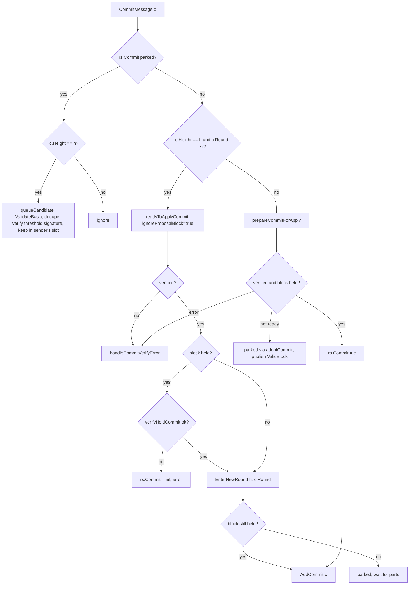

# Commit handling

A *commit* for height `h` is `(Height, Round, BlockID, QuorumHash,
ThresholdBlockSignature, ThresholdVoteExtensions)` (`types.Commit`). A node
obtains one in two ways:

1. **locally**, from its own precommit vote set once the threshold signature
   is recovered (`VoteSet.MakeCommit`);
2. **from a peer or the WAL**, as a `CommitMessage`.

In both cases the block must be held, processed by the application for the
commit's round, validated, and its extension vector accepted by the
application before it is saved and finalized.

## Commit verification

`ValidatorSet.verifyCommit` (`types/validator_set.go`) checks:

1. `commit.Height == height` and `commit.BlockID == blockID` (hash, part-set
   header, state id);
2. `commit.QuorumHash == Validators.QuorumHash` (`ErrInvalidCommitQuorumHash`);
3. the number of extension signatures matches the number of extensions and is
   `≤ MaxVoteExtensions` (`ErrVoteExtensionCountMismatch`);
4. the block threshold signature and every extension threshold signature
   verify against `ThresholdPublicKey` over the canonical vote sign items
   (`QuorumSignData.Verify`); failure → `ErrInvalidCommitSignature`.

Only `ErrInvalidCommitSignature` identifies a dishonest sender (an honest
node stores a commit only after verifying it) and leads to eviction
(`TryAddCommitAction.handleCommitVerifyError`); every other failure is only
counted in `CommitVerifyFailures{reason}`. Replayed commits never evict.

Consensus verifies a received commit **against the commit's own `BlockID`**
(`StateData.readyToApplyCommit`), not against the proposal it holds: a
proposal the network never committed proves nothing about the commit, and
checking against it rejected genuine commits (dashpay/tenderdash#1414). Step 1
above is therefore tautological on this path and the block is matched to the
commit afterwards by `verifyCommitBlock`.

## Applying a commit built from local precommits

Entered through `EnterCommitAction` → `TryFinalizeCommitAction`
(`internal/consensus/state_try_finalize_commit.go`).

- **Precondition:** `Step == ApplyCommit`, `maj23(Precommits(CommitRound))`
  is a non-nil `B`.
- If the node does not hold `B` (`!ProposalBlock.HashesTo(B.Hash)`) the
  action returns quietly; `EnterCommit` has already retargeted the part set
  to `B` and published a `ValidBlock` event, so peers send `B`'s parts; when
  the last part arrives `ProposalCompletedAction` (step `ApplyCommit`)
  dispatches `TryFinalizeCommit` again.
- `finalizeCommit`: `seenCommit = Precommits(CommitRound).MakeCommit()`;
  `refuseUnprocessedCommit`; `mustEnsureProcess(rs, seenCommit.Round)`;
  `verifyCommitExtensions` (ABCI `VerifyVoteExtension` on the canonical
  commit vote). If the application **rejects** its own quorum's extension
  vector, nothing is persisted, the failure is counted, and the node stays in
  `ApplyCommit` waiting for a peer's commit (a panic would restart into the
  same commit). Otherwise `Dispatch(ApplyCommit{seenCommit})`.

`ApplyCommitAction.Execute` is specified in
[happy path §9](./consensus-happy-path.md#9-commit-and-apply). Note that it
re-runs `ProcessProposal` if the block was last processed for a different
round than `commit.Round` (`mustEnsureProcess`), so the number of
`ProcessProposal` calls per height is not bounded by one.

## Commits received from peers

`CommitMessage` (vote channel) → `commitMessageHandler` →
`TryAddCommitAction.Execute` (`internal/consensus/state_try_add_commit.go`).

### `readyToApplyCommit` (`internal/consensus/state_data.go`)

1. `commit.ValidateBasic()` (non-nil block id, signature size, known
   extension types).
2. `commit.Height + 1 == h` → ignored ("old commit"); `commit.Height ≠ h` →
   ignored. There is no `LastCommit` vote set to feed.
3. `verifyCommitSignatures(commit.BlockID, commit)` — the threshold
   signature check, charged to the sender's verification budget.
4. If a **complete** block is held whose part set has the commit's header but
   whose hash differs → error ("retained block does not hash to commit
   hash"): parts determine the block, so waiting cannot resolve it.
5. With `ignoreProposalBlock` (future round): `adoptCommit` and return ready.
6. If `holdsProposalBlock(commit.BlockID)` → ready.
7. Else `adoptCommit(commit)`: `retargetTo(commit.BlockID, park)` — drops a
   proposal for another block, replaces the part set unless it already has
   the commit's header — and `rs.Commit = commit`; return not ready
   (**parked**).

### Held block: `verifyCommitBlock` and `verifyProcessedCommit`

- `verifyCommitBlock`: part-set header, block hash and **state id** of the
  commit must equal the held block's. A state-id mismatch is fatal for the
  commit: applied anyway, it would be recorded with a block id the next
  height's `LastBlockID` could never match.
- `verifyProcessedCommit`: `refuseUnprocessedCommit` (expectations cache),
  `ensureProcess(rs, commit.Round)` (`ProcessProposal` for the commit's
  round if not already processed; `ErrClientStopped` **panics**),
  `validate`, `verifyCommitExtensions` (ABCI). A failure returns an error;
  the commit is not applied.

### Commit for the current round (or earlier)

`prepareCommitForApply(ignoreProposalBlock = false)`: `readyToApplyCommit`,
then `verifyCommitBlock`, then `verifyProcessedCommit`. On success
`rs.Commit = commit` and `Dispatch(AddCommit{commit})`. When the block is not
held the commit is parked and a `ValidBlock` event is published so peers
serve the block.

### Commit for a later round

`commit.Round > r`: `readyToApplyCommit(ignoreProposalBlock = true)` verifies
the signature and parks the commit. If the block is already held it is
verified first (`verifyHeldCommit`), so that a rejected commit does not move
the round (on rejection `rs.Commit` is reset — the retarget could at most
have dropped a proposal whose state id differed, which such a commit could
not have matched anyway). Then `EnterNewRound(h, commit.Round)` — which keeps
the committed block as the download target — and, if the block is held,
`AddCommit`.

### `AddCommitAction.Execute` (`internal/consensus/state_add_commit.go`)

1. `proposalUpdater.updateStateData(commit.BlockID)`: install the locked
   block if it is the committed one, else retarget.
2. If `ProposalBlock == nil` (not held): return; the completing part will
   dispatch `AddCommit` again via `selectParkedCommit`.
3. `Step = ApplyCommit` (round kept), `CommitRound = commit.Round`,
   `CommitTime = now`; `Dispatch(ApplyCommit{commit})`
   ([happy path §9](./consensus-happy-path.md#9-commit-and-apply));
   `PublishCommitEvent` (peers receive `HasCommit`);
   `Dispatch(EnterNewRound{Height: rs.Height})` for the new height.

### Parked commit and replacement candidates

While `rs.Commit ≠ nil`, further commits for the height are not applied but
**queued** (`TryAddCommitAction.queueCandidate`,
`internal/consensus/commit_candidates.go`): after `ValidateBasic` and
deduplication against the parked commit and the sender's previous candidate,
the threshold signature is verified and the commit is stored in the sender's
single slot (overwritten by that sender's later commits; freed on
disconnect). Candidates are keyed by `(height, round, blockID, hash of the
extension vector)` because the application's verdict depends on all four.

When the block completes (`addProposalBlockPart` with `rs.Commit ≠ nil`),
`selectParkedCommit` tries the parked commit and then the candidates, grouped
by round (the round already processed first, then rounds in arrival order),
calling `verifyHeldCommit` for each; the first accepted becomes `rs.Commit`
and is dispatched as `AddCommit`. If none is accepted, `rs.Commit = nil` and
the completed block continues through the ordinary flow
(`ProposalCompleted`).

`commitExpectations` (`internal/consensus/commit_expectations.go`) remembers,
per `(height, round, block)`, the extension vector the application's own
`ExtendVote` returns after a rejection, and whether that vector was itself
rejected. A later commit for the same `(round, block)` with a different
vector, or with the rejected one, is refused without re-processing the block
(`blockExecutor.refuseUnprocessedCommit`, `verifyCommitExtensions`). The
block and round are authenticated by the threshold signature, the vector is
not, so this bounds `ProcessProposal` re-executions per height to roughly one
per foreign round plus returns to the node's own round.

## Commit validity depends on the application

A commit's acceptability includes an ABCI verdict (`VerifyVoteExtension` on
the commit vote). Two signature-valid commits for the same block can differ
in round or extension vector and receive different verdicts; liveness
therefore depends on the application answering deterministically for the
round the quorum signed.

## Interaction with the step machine

- `Proposaler.Set` refuses a proposal that disagrees with a parked commit for
  the same round and ignores a later-round proposal that would disrupt the
  download of a parked commit's block.
- `EnterNewRound` keeps the part set targeted at a parked commit's block and
  re-announces it (`ValidBlock` event).
- `EnterPropose` does not propose while a verified commit for a held block is
  about to be applied (`applyingCommit`).
- `AddProposalBlockPart` dispatches `ProposalCompleted` only when no commit
  is parked or the parked one was just rejected.

## Commit gossip

(`internal/consensus/gossip_handlers.go`, `gossiper.go`, `reactor.go`)

- After applying a commit the node broadcasts `HasCommit`
  (`PublishCommitEvent` → reactor broadcast) and every step change
  broadcasts `NewRoundStep`.
- Per peer, the vote/commit gossip loop sends `CommitMessage`:
    - `rs.LastCommit` when the peer is exactly one height behind and has not
      announced the commit (`shouldCommitBeGossiped`);
    - the stored commit for the peer's height when it is two or more heights
      behind (`shouldCommitBeGossipedForCatchup`, `blockStore.LoadBlockCommit`
      / `LoadSeenCommit`).
- Block parts for a lagging peer come from the block store, one per tick,
  with a quiet gap of `catchupResendInterval` between passes
  (`GossipBlockPartsForCatchup`); a non-validator peer at the current height
  receives parts once it announced a commit (`shouldBlockPartsBeGossiped`).
- `VoteSetMaj23` for the stored commit is sent to validator peers that
  announced a catch-up commit round (`GossipVoteSetMaj23`).
