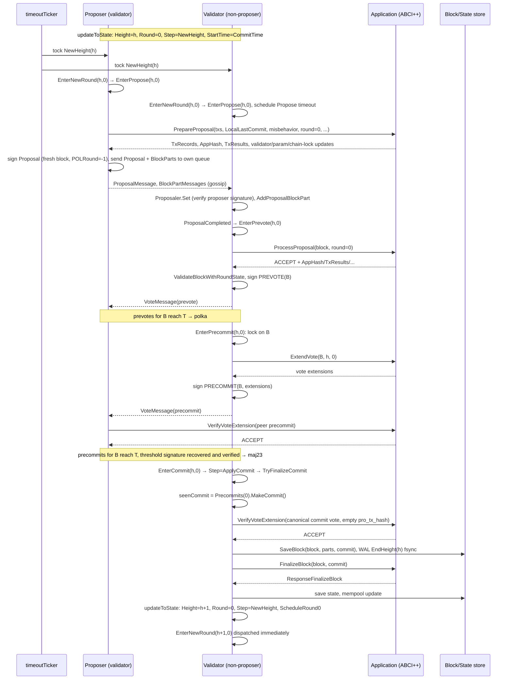

# Primary flow of a height

This page follows one height `h` through round 0 when every validator is
honest, the network is timely and the application accepts everything. Every
step names the function that performs it. Alternative paths branch off at the
points marked **⇢** and are specified in
[Alternative flows](./consensus-alternative-flows.md) and
[Commit handling](./consensus-commit.md).

## Sequence

The proposer runs the same validator steps for its own proposal: its
`ProposalMessage` and `BlockPartMessage`s travel through the internal queue
and are handled exactly like a peer's (`Proposaler.sendMessages`,
`msgInfoDispatcher`).

## Step by step

### 1. New height

Precondition: a block for `h − 1` was just applied, or the node started.

`StateData.updateToState` (`internal/consensus/state_data.go`) sets
`Height = h`, `Round = 0`, `Step = NewHeight`, `LastCommit`, a fresh
`HeightVoteSet`, a fresh `ProposerSelector` (from `ConsensusParams.Version`
and the block store), resets proposal/lock/valid/commit fields, and sets
`StartTime = CommitTime` (or `now` when there is no commit time yet).
`roundScheduler.ScheduleRound0` arms a `NewHeight`-step timeout of
`StartTime − now` (≤ 0, so it fires at once).

On the vote-driven path the next height does not even wait for that tock:
`addVoteDispatchPrecommitMw` (`internal/consensus/state_add_vote.go`)
dispatches `EnterNewRoundEvent{Height: stateData.Height}` right after
`EnterCommit` returned, and because `ApplyCommit` already incremented the
height in place, that is `EnterNewRound(h + 1, 0)`. The later `NewHeight`
tock then fails the `EnterNewRound` guard and is ignored.

### 2. New round

`State.handleTimeout` (`internal/consensus/state.go`) maps the `NewHeight`
tock to `EnterNewRoundEvent{Height}`. `EnterNewRoundAction.Execute`
(`internal/consensus/state_enter_new_round.go`):

- guard: `Height == h`, `round ≥ Round`, and if `round == Round` then
  `Step == NewHeight`;
- `updateRoundStep(0, NewRound)` (this also updates the proposer selector);
- for round 0 the proposal fields are kept as reset by `updateToState`
  (a proposal for round 0 may already have arrived);
- `Votes.SetRound(1)` so that round 1 votes are tracked for round skipping;
- `TriggeredTimeoutPrecommit = false`;
- decides whether to wait for transactions:
  `waitForTxs = config.WaitForTxs() && round == 0 && Height != InitialHeight`,
  overridden to `false` by `ProposeNextBlockImmediately`. **⇢**
  [Empty blocks](./consensus-alternative-flows.md#mempool-and-empty-blocks).
  With the default configuration (`create-empty-blocks = true`,
  interval 0) it does not wait and dispatches `EnterProposeEvent{h, 0}`.

### 3. Propose

`EnterProposeAction.Execute` (`internal/consensus/state_enter_propose.go`):

- guard: `Height == h`, `round ≥ Round`, and if `round == Round` then
  `Step < Propose`;
- `isProposer = ProposerSelector.GetProposer(Height, Round).ProTxHash == own pro-tx-hash`
  ([Proposer selection](./proposer-selection.md));
- if the node is the proposer and `state.LastBlockTime > now`, it
  reschedules a `NewRound`-step timeout for the difference and returns
  **without changing step** (block times must increase; `proposerWaitTime`
  in `internal/consensus/state.go`). **⇢**
  [Known issues](./consensus-known-issues.md#proposer-clock-wait-can-be-swallowed-by-the-ticker);
- schedules the `Propose` timeout `proposeTimeout(round)`;
- non-proposers return here and wait for the proposal;
- the proposer, unless replaying the WAL, applying a parked commit, or
  suppressed after block sync (`catchupTracker.mayPropose`), flushes the WAL
  and calls `Proposaler.Create`;
- on return (deferred): `updateRoundStep(round, Propose)`, publish the step,
  and if `isProposalComplete()` already holds, dispatch `EnterPrevote`.

#### 3a. Creating the proposal (proposer only)

`Proposaler.Create` (`internal/consensus/state_proposaler.go`):

1. If `checkValidBlock(rs)` — `ValidBlock != nil` and it is timely with
   respect to `ValidBlockRecvTime` and `ValidRound` (or has the genesis time
   at `InitialHeight`) — reuse `ValidBlock`; otherwise build a new block via
   `blockExecutor.create` → `BlockExecutor.CreateProposalBlock`
   (`internal/state/execution.go`):
    - `commit = LastCommit` (an empty commit at `InitialHeight`);
    - `evidence = evpool.PendingEvidence(ConsensusParams.Evidence.MaxBytes)`;
    - `maxDataBytes = types.MaxDataBytes(Block.MaxBytes, commit, evidenceSize)`
      (block overhead, max header, max core chain lock, the last commit's
      actual size and evidence are subtracted; `types/block.go`);
    - `txs = mempool.ReapMaxBytesMaxGas(maxDataBytes, Block.MaxGas)`;
    - `state.MakeBlock(...)` with `Time = now` (genesis time at
      `InitialHeight`), `ProposerProTxHash = own`, `ProposedAppVersion`;
    - ABCI `PrepareProposal` with `MaxTxBytes`, `Txs`, `LocalLastCommit`,
      `Misbehavior`, `Height`, `Round`, `Time`, `NextValidatorsHash`,
      `CoreChainLockedHeight = state.LastCoreChainLockedBlockHeight`,
      `ProposerProTxHash`, `ProposedAppVersion`, `Version`, `QuorumHash`.
      An error from the call **panics** the node (`blockExecutor.create`); a
      response that differs for an identical request is only logged
      (`deterministicPrepareProposalHashes`);
    - the response is validated; removed transactions are evicted from the
      mempool; `AppHash`, `ResultsHash`, `NextValidatorsHash`,
      `NextConsensusHash`, `CoreChainLock`, `AppVersion` and the
      next validator set/params are written into the header and
      `CurrentRoundState` (`RoundParamsFromPrepareProposal`,
      `CurrentRoundState.UpdateBlock`).
2. `makeProposal(h, round, polRound, block, parts)`, where
   `polRound = ValidRound` when `ValidBlock` is re-proposed and
   `polRound = -1` when a new block was built. A new block has no polka, so
   it never claims one.
3. `signProposal`: `PrivValidator.SignProposal(chainID, QuorumType, QuorumHash, proposal)`
   with a context deadline of `Timeout.Propose`. The proposal signature
   covers `Type, Height, Round, POLRound, BlockID (hash + part-set header),
   Timestamp, ChainID` (`CanonicalizeProposal` in `types/canonical.go`); it
   does **not** cover `CoreChainLockedHeight` or `BlockID.StateID`.
4. `sendMessages`: `ProposalMessage` then one `BlockPartMessage` per part
   (`BlockPartSizeBytes`), all to the internal queue. The reactor gossips them
   to peers from the resulting round-state events.

### 4. Receiving the proposal and block

`proposalMessageHandler` → `Proposaler.Set` (`internal/consensus/state_proposaler.go`)
accepts the proposal when it is the first for the round, is for the current
`(Height, Round)`, has a valid `POLRound`, a core-chain-locked height not
below the committed one, agrees with any block/part set already held, and
carries a valid proposer signature (`verifyProposal`; full rules in
[Proposal validity](./consensus-transitions.md#proposal-acceptance-proposalerset)).
It records `ProposalReceiveTime` (the queue's enqueue time,
`chanMsgSender.send` in `internal/consensus/msg_queue.go`) and creates the
part set from `BlockID.PartSetHeader` unless one is under way.

`blockPartMessageHandler` → `AddProposalBlockPartAction.Execute`
(`internal/consensus/state_add_prop_block.go`) adds each part (Merkle proof
checked by `PartSet.AddPart`). When the last part arrives the block is
decoded, cross-checked against the proposal (hash and part-set header must
match, else the proposal is dropped), the proposal's `CoreChainLockedHeight`
and `BlockID.StateID` are replaced by the values derived from the block,
`rs.ProposalBlock` is set and `ProposalCompletedEvent` is dispatched.

`ProposalCompletedAction.Execute`: with `Step ≤ Propose` and
`isProposalComplete()` (proposal and block held, and for `POLRound ≥ 0` the
POL round's prevotes already have a majority) → `EnterPrevote(h, Round)`.

### 5. Prevote

`EnterPrevoteAction.Execute` (`internal/consensus/state_enter_prevote.go`)
→ `prevoter.Do` (`internal/consensus/state_prevoter.go`):

1. `StateData.isValidForPrevote`: block and proposal held; proposal timestamp
   equals block time; the proposal is timely (unless replaying or the block is
   already `ValidBlock`); the core chain lock is consistent
   (`sm.ValidateBlockChainLock`); for `POLRound == -1` the block's
   `ProposerProTxHash` is this round's proposer.
2. `blockExecutor.ensureProcess(rs, Round)` → ABCI `ProcessProposal`
   (`verify = true`): the response must be `ACCEPT`, well-formed, and
   `ValidateBlockWithRoundState` must pass — header fields `AppHash`,
   `ResultsHash`, `NextValidatorsHash`, `NextConsensusHash` must equal the
   application's answer, `LastCommit` must verify against `LastValidators`,
   and the core chain lock must validate. The result becomes
   `CurrentRoundState` tagged with round 0.
3. `blockExecutor.mustValidate` (panics on failure, cannot fail after step 2).
4. `prevoter.signVote`: with no lock and `POLRound == -1`,
   `checkProposalBlock` is true → `voteSigner.signAddVote(PrevoteType, BlockID)`.

Step `Prevote` is set on return. Any failure in 1–2 yields a **nil prevote**
instead. **⇢** [Prevote rule](./consensus-transitions.md#prevote-decision-prevoterdo).

### 6. Collecting prevotes

Each `VoteMessage` runs the prevote middleware chain
(`newAddVoteAction` in `internal/consensus/state_add_vote.go`). Once
`Prevotes(0)` holds `T` power for `B`:

- `addVoteUpdateValidBlockMw`: `ValidRound < 0 == Round` and the held block
  is `B` → `updateValidBlock()` (`ValidRound = 0`, `ValidBlock = B`,
  `ValidBlockRecvTime = ProposalReceiveTime`), `retargetTo(B)` (a no-op here),
  publish a `ValidBlock` event (peers learn the part-set header);
- `addVoteDispatchPrevoteMw`: `Round == vote.Round`, `Step ≥ Prevote`,
  majority for `B` and `isProposalComplete()` → `EnterPrecommit(h, 0)`.

### 7. Precommit

`EnterPrecommitAction.Execute` (`internal/consensus/state_enter_precommit.go`):
polka for `B`; proposal and block held; timestamps equal; `B` is this
round's proposal block → `mustEnsureProcess(rs, 0)` (no new ABCI call: round 0
is already processed), `mustValidate`, `updateLockedBlock()`
(`LockedRound = 0`, `LockedBlock = B`), `Lock` event,
`signAddVote(PrecommitType, B)`, then `updateValidBlock()` (already current).

`voteSigner.signVote` for a non-nil precommit first calls ABCI `ExtendVote`
(`BlockExecutor.ExtendVote`; an error or an invalid extension **panics**),
attaches the returned extensions, and signs with deadline `voteTimeout(0)`.
The vote carries one BLS share for the block sign item and one per extension
([Signing](./signing.md)).

### 8. Collecting precommits

The precommit middleware chain adds `addVoteVerifyVoteExtensionMw` before the
vote set: for a peer's non-nil precommit it verifies the block signature and
every extension signature (`types.VerifyVoteSignatures`), restores the node's
own processed round if a commit check changed it (`blockExecutor.ensureOwnRound`),
and asks ABCI `VerifyVoteExtension`; a rejection drops the vote (it is not
stored, so gossip may redeliver it).

When `Precommits(0)` for `B` reaches `T` **and** threshold recovery succeeds
([Threshold recovery](./consensus.md#threshold-recovery)),
`addVoteDispatchPrecommitMw` dispatches `EnterNewRound(0)` (no-op),
`EnterPrecommit(0)` (no-op) and `EnterCommitEvent{h, CommitRound: 0}`.

### 9. Commit and apply

`EnterCommitAction.Execute` (`internal/consensus/state_enter_commit.go`):
guard `Height == h`, `Step < ApplyCommit`; `proposalUpdater.updateStateData`
confirms the held block is `B`; deferred: `Step = ApplyCommit` (round kept),
`CommitRound = 0`, `CommitTime = now`, then `TryFinalizeCommitEvent`.

`TryFinalizeCommitAction.Execute` → `finalizeCommit`
(`internal/consensus/state_try_finalize_commit.go`): `seenCommit =
Precommits(CommitRound).MakeCommit()` (height, round, block id, quorum hash,
recovered block signature, recovered extension signatures);
`refuseUnprocessedCommit` (cache of rejected vectors, empty here);
`mustEnsureProcess(rs, seenCommit.Round)`; `verifyCommitExtensions` → ABCI
`VerifyVoteExtension` with the commit's canonical vote (empty
`ValidatorProTxHash` marks it as a commit, `sm.VerifyCommitExtensions`). On
acceptance → `ApplyCommitEvent{seenCommit}`.

`ApplyCommitAction.Execute` (`internal/consensus/state_apply_commit.go`):

1. `verifyCommitBlock`: part-set header, hash and state id of the commit
   equal those of the held block.
2. `mustEnsureProcess(rs, commit.Round)`, `mustValidate`.
3. `blockStore.SaveBlock(block, parts, commit)`.
4. WAL `WriteSync(EndHeightMessage{h})` — **panics** on failure.
5. `blockExecutor.finalize` → `BlockExecutor.FinalizeBlock`
   (`internal/state/execution.go`): `ValidateBlockWithRoundState` again,
   `SaveABCIResponses` (the `ProcessProposal` result, for crash recovery),
   ABCI `FinalizeBlock` (block, commit, round, block id), `State.Update`
   (`Validators ← NextValidators`, `LastValidators ← Validators`, params,
   chain-lock height, `LastAppHash`), mempool flush and update
   (`flushMempool`, recheck per `ABCI.RecheckTx`), evidence-pool update,
   `stateStore.Save`, pruning per `RetainHeight`, events. An error
   **panics** the node.
6. `updateToState(newState, commit)` → height `h + 1`, step `NewHeight`.
7. `ProposeNextBlockImmediately` is set if the response asks for it.
8. `ScheduleRound0`.

Control then returns through the dispatch stack to
`addVoteDispatchPrecommitMw`, which dispatches `EnterNewRound(h + 1, 0)`
immediately (step 1 above).

## ABCI calls per height on the happy path

| Node role | Calls |
| ----------- | ------- |
| Proposer | `PrepareProposal`, `ProcessProposal`, `ExtendVote`, `VerifyVoteExtension` × (n − 1 peer precommits) + 1 (commit), `FinalizeBlock` |
| Other validator | `ProcessProposal`, `ExtendVote`, `VerifyVoteExtension` × (n − 1) + 1, `FinalizeBlock` |
| Observer (not in the validator set) | `ProcessProposal` (once a `CommitMessage` and the block arrive; peers gossip proposals only to validators), `VerifyVoteExtension` × 1 (commit), `FinalizeBlock` — observers neither prevote nor precommit, see [Non-validators](./consensus-alternative-flows.md#non-validators-and-signer-problems) |

There is no ABCI `Commit` call: the method is removed from the Tenderdash
ABCI protocol (`proto/tendermint/abci/types.proto` reserves its field
number). Several `ProcessProposal` calls per height are possible whenever a
later round, a commit for another round, or a block-sync handover requires
re-processing (`blockExecutor.ensureProcess`).
