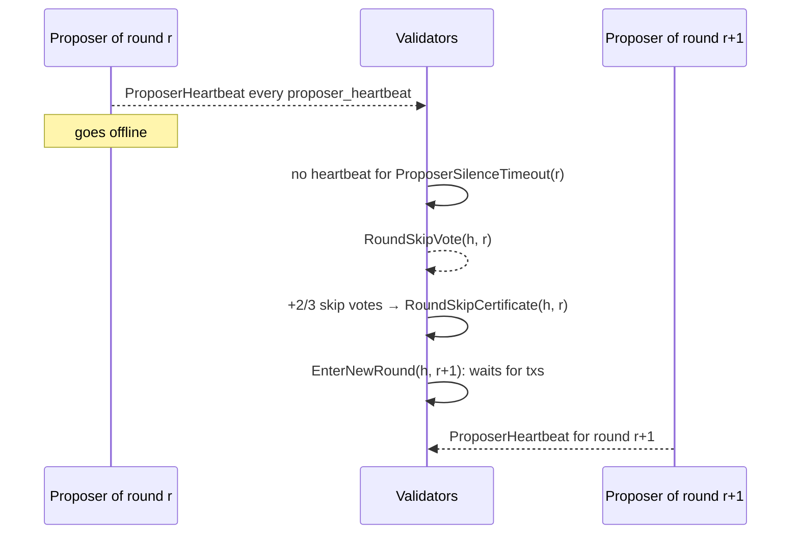

# Proposer liveness and round skipping

A round that waits for transactions has no timeout running unless
`create-empty-blocks-interval` is set, so a proposer that is offline while the
chain is idle is only noticed once a transaction arrives, and that transaction
then waits out the propose timeout. From `CONSENSUS_VERSION_2` the proposer of
a waiting round announces itself with signed heartbeats, and validators that
stop hearing them hand the round to the next proposer with a threshold-signed
round skip certificate.

Wire formats are in [Consensus channel messages](../p2p/messages/consensus.md);
sign bytes and request IDs in
[Signing](./signing.md#proposer-heartbeats-and-round-skip-votes).

## When it applies

`roundSkipping` (`internal/consensus/proposer_liveness.go`) gates everything on
this page. It holds when both:

- `ConsensusParams.Version.ConsensusVersion ≥ 2`
  (`VersionParams.ProposerLivenessEnabled`, `types/params.go`), and
- `types.RoundSkipsProvable(Validators)`: `T ≤ R`, i.e. a
  `VotingPowerThreshold` above the recovery threshold disables round skipping,
  because a certificate only proves that shares worth `R` signed
  (`types/round_skip.go`).

Otherwise no heartbeat is sent or accepted, no skip vote is signed or
collected, every certificate is dropped, and the node behaves as on version 0
or 1.

A node **waits for transactions** in its round (`waitingForTxs`) while
`roundSkipping ∧ step == NewRound ∧ Commit == nil`; liveness is tracked while
it also holds no proposal for the round (`waitingRound`). Whether a round waits
at all is decided by `EnterNewRoundAction.Execute`
([Mempool and empty blocks](./consensus-alternative-flows.md#mempool-and-empty-blocks)).
On a version-2 chain a wait also ends, with `Dispatch(EnterPropose{h, r})`,
when:

- a proposal for the round is accepted (`proposalMessageHandler`,
  `internal/consensus/msg_handlers.go`); a round-0 proposal accepted before the
  round starts keeps the round from waiting at all;
- a prevote is added while the node waits and the added prevote's round (this
  round or an earlier one) has a polka, or the prevote is for the current round
  and `r > 0` (`addVoteDispatchPrevoteMw`).

A proposal or polka shows that a block is under way; from then on the
propose timeout, not the heartbeats, moves the round on.

## Heartbeats

`State.followLiveness` (`internal/consensus/state.go`) runs once before the
receive routine's first input and after every input. It calls
`proposerLiveness.reconcile`, which, while `waitingRound` holds, either
**announces** (this node is `proposer(h, r)`) or **watches** (any other node);
otherwise it stops both.

Sending (`proposerLiveness.sendHeartbeats`, `sendHeartbeat`):

- one heartbeat at once and then every `ProposerHeartbeat`, until the node
  leaves the round;
- only while the node could propose (`State.proposerReady`): the propose step
  would not suppress it after a block-sync handover (`catchupTracker.mayPropose`)
  and the application answers ABCI `Echo` on every backend that receives
  `PrepareProposal` (`BlockExecutor.AppReady` in `internal/state/execution.go`,
  `abciclient.EchoRoute`) within the interval. At most one probe is in flight
  (`appReadiness`, `internal/consensus/app_readiness.go`);
- `Sequence = max(last + 1, signing time in Unix ms)` (`heartbeatSequence`);
- one heartbeat is signed at a time, whatever its round; a heartbeat whose
  round the node left while signing is dropped. A signer error wrapping
  `types.ErrSigningNotSupported` stops heartbeats for the rest of the process
  (`signerUnsupported`).

Receiving: the reactor screens a heartbeat without a signature check
(`proposerLiveness.wanted` → `screen`) and queues it in the sender's lane; the
consensus goroutine verifies it (`proposerLiveness.heard`, called from
`State.handleLivenessMessage`). A heartbeat is accepted iff:

1. its height is the node's and its round is within the relay window
   `[max(r − 4, 0), r + 4]` (`relayWindow`, `maxRoundSkipRoundsAhead`);
2. it names `proposer(h, round)`, otherwise `errProposerHeartbeatWrongProposer`;
3. it was not seen before, identified by `(height, round, sequence, timestamp)`
   (`heartbeatID`; at most `maxSeenHeartbeats = 256` remembered);
4. its timestamp is within the silence timeout of local time, in either
   direction;
5. the node holds the proposer's public key share (validators only);
6. the round's pace has a token: one per half heartbeat interval, burst 2
   (`heartbeatPaceBurst`);
7. the verification budget allows one check and `ProposerHeartbeat.Verify`
   succeeds (`types/proposer_heartbeat.go`).

An accepted heartbeat for the round the node watches re-arms its silence timer;
one for a nearby round is only relayed. Every accepted heartbeat is relayed
once. Heartbeats go only to validator peers at the same height whose round is
within the relay window of the heartbeat's round, never back to the sender
(`Reactor.sendHeartbeat`, `wantsHeartbeat` in `internal/consensus/reactor.go`).
A heartbeat changes no consensus state and is not written to the WAL.

## Silence and skip votes

The watch arms a timer of `ProposerSilenceTimeout(r) = ProposerSilence +
ProposerHeartbeat · r`, saturating at the maximum duration
(`TimeoutParams.ProposerSilenceTimeout`, `types/params.go`). When it fires,
`State.handleProposerSilence` acts only if the report is still current (same
height and round, still waiting, no heartbeat re-armed the timer since) and
the node is a validator. `ProposerSilences` counts the first report of a round.

`State.voteToSkipRound` then:

- if this validator's vote for the round is already counted, broadcasts it
  again;
- otherwise has `RoundSkipVote{h, r, own pro-tx-hash, own index}` signed off
  the consensus goroutine (`roundSkipSigner`,
  `internal/consensus/round_skip_signer.go`), one vote at a time, with the
  silence timeout as the signing deadline. If a vote is still being signed,
  this one is retried after another silence timeout.

`State.handleSignedRoundSkipVote` drops the result if the node left the round
or a heartbeat arrived meanwhile. `ErrSigningNotSupported` ends the attempt;
any other signing error retries after another silence timeout. A signed vote
is counted, broadcast, and broadcast again every silence timeout while the
round stays silent.

A skip vote is **not** a prevote: it locks nothing, and the validator still
prevotes and precommits the round's proposal if one arrives. Every validator
signs the same bytes for `(h, r)`, so a validator can make only one skip vote
per round.

## Collecting votes and recovering the certificate

`roundSkipCollector` (`internal/consensus/round_skip_collector.go`) holds the
skip votes of the current height and quorum for rounds `[r, r + 4]`. Votes of
rounds below `r` are dropped when the node moves on. A vote from a peer is
counted iff its index and pro-tx-hash name the same validator (otherwise
`errRoundSkipVoteWrongValidator`), it is not already counted, the round is not
already certified, the node holds the validator's key share, the verification
budget allows one check, and `RoundSkipVote.Verify` succeeds.

A vote is relayed when first counted. A copy of a counted vote that arrives at
least half a silence timeout after the last relay has the counted vote relayed
again, until the round is certified (`roundSkipCollector.relayAgain`). Skip
votes are not written to the WAL.

Once the counted power reaches
`RoundSkipThresholdPower = max(T, R)` (`types/round_skip.go`; equal to `R`
whenever `roundSkipping` holds), `RecoverRoundSkipCertificate` recovers the
quorum threshold signature over the round's sign bytes from the shares and
verifies it against `ValidatorSet.ThresholdPublicKey`. A failed recovery is
retried at once with any votes counted meanwhile, otherwise with the next vote.
The recovered certificate is dispatched immediately on the consensus goroutine
(`State.applyRecoveredCertificate`).

## Applying a certificate

`AddRoundSkipCertificateAction.Execute`
(`internal/consensus/state_add_round_skip.go`):

- **Guard** (`roundSkipCertificateWanted`, also checked by the reactor before
  queuing): `roundSkipping ∧ cert.Height == h ∧ (RoundSkip == nil ∨ cert.Round > RoundSkip.Round) ∧ step < ApplyCommit`.
- **Actions:**
    1. Unless this node recovered it: charge the verification budget and
       `RoundSkipCertificate.Verify` (quorum hash must equal the validator
       set's, else `ErrRoundSkipCertificateWrongQuorum`; threshold signature
       against `ThresholdPublicKey`).
    2. Write the message it came in to the WAL (`Write`, no fsync); not on
       replay.
    3. `RoundSkip = cert`; broadcast it.
    4. If `cert.Round < r`: stop (the certificate is kept for peers still in
       that round). Else count `RoundSkips` and
       `Dispatch(EnterNewRound{h, cert.Round + 1})`.

The certificate does not touch locks, valid blocks or vote sets; it only moves
the node to a higher round, which the locking rules make safe.

## The round after a skip

`EnterNewRoundAction.Execute` lets round `R > 0` wait for transactions, as
round 0 does, when `StateData.waitsAfterRoundSkip(R)` holds
(`internal/consensus/state_data.go`):

- `RoundSkip.Round == R − 1`;
- `LockedRound == -1 ∧ ValidRound == -1`;
- the mempool has not reported transactions at this height (`TxsReported`; the
  mempool reports once per height, and `State.handleTxsAvailable` records the
  report in any round);
- no polka at the height (`HeightVoteSet.POLInfo` round `-1`) and no prevote
  recorded for round `R`.

The other wait conditions are unchanged (`WaitForTxs()`, `h ≠ InitialHeight`,
no `ProposeNextBlockImmediately`). A waiting round `R > 0` publishes its
`NewRound` step, so peers send it the round's proposal. The empty-block tock is
scheduled after `max(CreateEmptyBlocksInterval − (now − StartTime), 0)`: the
interval counts from the start of the height, not from the skipped round.

## Gossip

Two gossip handlers run per peer at the `PeerQueryMaj23SleepDuration` cadence
(`internal/consensus/gossip_handlers.go`, wired in `gossip_peer_worker.go`):

- `roundSkipGossipHandler` sends the held `RoundSkip` to every peer at the
  height that is not committing and has not sent a certificate for that round
  or a later one (`PeerState.HasRoundSkip`). Nothing else moves a peer out of a
  skipped round: it has no votes to follow and the next proposal is sent only
  to peers already in the next round.
- `roundVoteResendGossipHandler` (`roundSkipping` only, validator peers) sends
  one random vote per pass: the round's prevotes to a peer waiting in this
  node's round `r > 0`; the prevotes and precommits of the peer's round, and of
  the latest later round with +2/3-any (`laterRoundVotes`), to a peer in a round
  this node has left.

## Recovery

- Certificates are WAL `msgInfo` records; replay applies them again without
  charging the verification budget. Replay never skips rounds on a
  `roundSkipping` chain (below).
- On a `roundSkipping` chain `WalSkipRoundsToLast` is ignored
  (`State.replaySkipsRounds`, `internal/consensus/replay.go`): whether a round
  after a certificate waits depends on polkas of earlier rounds.
- The mempool report is not in the WAL. On a `roundSkipping` chain a replayed
  `Propose` step event for the current height enters the recorded round, and
  enters the propose step if replay left the node waiting
  (`State.readReplayMessage`).
- After a restart into a waiting round the heartbeat or watch starts before the
  first input (`State.followLiveness`).

## Message admission and budgets

- **State channel.** `ProposerHeartbeat`, `RoundSkipVote` and
  `RoundSkipCertificate` travel on the state channel (`p2p.ResolveChannelID`).
  Each pays the state-channel cost of 1 on arrival and `livenessTokenCost`
  (100) more only once the checks that need no signature find it new
  (`Reactor.chargeLivenessNews`); it then joins the sender's peer lane.
- **Verification budget.** Each costs `baseMessageCost` (1) to verify
  (`peerMessageCost`, `budgetedMessageCost` in
  `internal/consensus/message_cost.go`). One that cannot be afforded is dropped;
  it is sent again.
- **Peer errors.** All rejections below are logged at Debug
  (`isPeerFloodableError`):
    - a liveness message that does not decode or fails its basic checks
      (`MsgFromProto`, `errMalformedLivenessMessage`) is reported as
      `p2p.ErrInvalidData`, on which the router disconnects the sender;
    - a heartbeat from the wrong proposer or a skip vote whose index and
      pro-tx-hash disagree, found by the reactor's screening, is a non-fatal
      peer error (`PeerStatusBad`);
    - a heartbeat, skip vote or certificate whose signature fails against the
      key the node holds is reported as a fatal peer error, which disconnects
      the sender (`forgedLivenessMiddleware`);
    - a certificate for another quorum (`ErrRoundSkipCertificateWrongQuorum`)
      is only logged.
- **Outboxes.** Liveness messages are sent from a reactor goroutine through a
  bounded outbox (`livenessOutboxSize = 256`), each send bounded by
  `voteSetResponseTimeout`; a message that finds the outbox full is dropped and
  sent again on its own schedule. Round-step, valid-block, `HasVote` and
  `HasCommit` broadcasts go through a separate outbox
  (`stateOutboxSize = 1024`); after a drop the sender rebroadcasts the current
  round step (`Reactor.sendState`). Neither blocks the consensus goroutine.

## Signers

`FilePV` (`privval/file.go`) and `DashCoreSignerClient`
(`privval/dash_core_signer_client.go`) sign heartbeats and skip votes
(`SignProposerHeartbeat`, `SignRoundSkipVote` of the `PrivValidator`
interface, `types/priv_validator.go`).
The socket and gRPC remote signers (`privval/signer_client.go`,
`privval/grpc/client.go`) return `RemoteSignerError` code 501, which matches
`types.ErrSigningNotSupported`. A validator behind such a signer sends no
heartbeats, so validators skip its waiting rounds after the silence timeout,
and it signs no skip votes; it still counts others' votes and applies
certificates.

## Parameters

`TimeoutParams.ProposerHeartbeat` (field 7) and `ProposerSilence` (field 8)
come from the committed state's consensus parameters, like the other timeouts.
`TimeoutParamsOrDefaults` derives the values in effect from what is stored:

| Stored heartbeat | Stored silence | Heartbeat in effect | Silence in effect |
| --- | --- | --- | --- |
| unset | unset | 1 s | 5 s |
| unset | `s` | `min(1 s, s / 5)` | `s` |
| `b` | unset | `b` | `max(5 s, 5·b)` |
| `b` | `s` | `b` | `s` |

- **Validation** (`ConsensusParams.ValidateConsensusParams`): neither negative;
  the derived heartbeat is positive and shorter than the derived silence.
- **Updates** (`ConsensusParams.UpdateConsensusParams`): an update that names
  either field, or that raises `ConsensusVersion` from below 2 to 2 or more,
  clears both and sets only those it names; the other is derived again.
- **Encoding** (`ConsensusParams.ToProto`): unset fields are omitted.
- **Hashing** (`ConsensusParams.HashConsensusParams`): from version 2,
  `HashedParams.proposer_heartbeat_ns` (field 4) and `proposer_silence_ns`
  (field 5) carry the values in effect, in nanoseconds; earlier versions leave
  them unset, so their hash is unchanged.

## Metrics

| Metric | Counts |
| --- | --- |
| `consensus_proposer_heartbeats_sent` | Heartbeats this node signed and broadcast |
| `consensus_proposer_heartbeats_received` | New, verified heartbeats for the round this node waits in |
| `consensus_proposer_silences` | Rounds in which this validator stopped hearing from the proposer while waiting |
| `consensus_round_skips` | Rounds this node moved past on a certificate |

Defined in `internal/consensus/metrics.go`.
