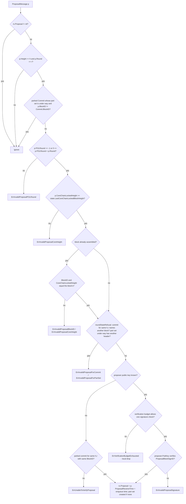
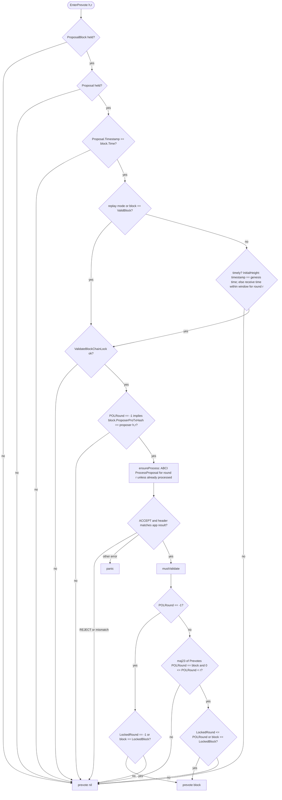
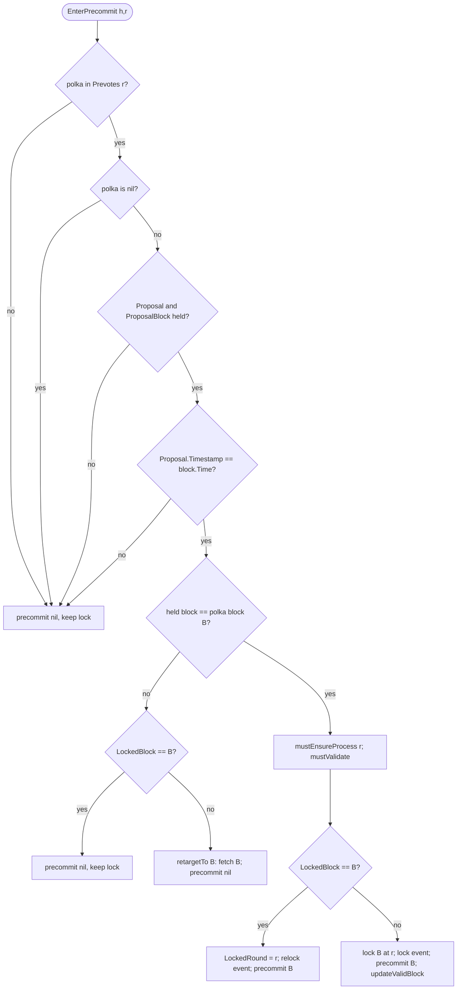

# Transitions and decision rules

This page is the formal core of the specification: for every action of the
state machine it gives the **precondition** (guard), the **actions** and the
**postcondition**, then the decision procedures that choose what to sign.
`Dispatch(X)` means `Controller.Dispatch` of event `X`; a dispatch whose guard
fails is a no-op.

Notation: `h = rs.Height`, `r = rs.Round`, `step = rs.Step`;
`Prevotes(x)` / `Precommits(x)` are `rs.Votes.Prevotes(x)` /
`rs.Votes.Precommits(x)`; `maj23(S)` is `S.TwoThirdsMajority()`;
`any23(S)` is `S.HasTwoThirdsAny()`; `complete()` is
`StateData.isProposalComplete()`.

## Inputs

| Input | Handler | Resulting dispatch |
| ------- | --------- | -------------------- |
| Tock `(H, R, NewHeight)` | `State.handleTimeout` | `EnterNewRound{H}` (round 0) |
| Tock `(H, R, NewRound)` | `State.handleTimeout` | `EnterPropose{H, R}` |
| Tock `(H, R, Propose)` | `State.handleTimeout` | publish `TimeoutPropose`; `EnterPrevote{H, R}` |
| Tock `(H, R, PrevoteWait)` | `State.handleTimeout` | publish `TimeoutWait`; `EnterPrecommit{H, R}` |
| Tock `(H, R, PrecommitWait)` | `State.handleTimeout` | publish `TimeoutWait`; `EnterPrecommit{H, R}`; `EnterNewRound{H, R + 1}` |
| `TxsAvailable` | `State.handleTxsAvailable` | only at `r == 0`: at step `NewHeight` (and `h ≠ InitialHeight`) schedule tock `(h, 0, NewRound)` after `StartTime − now + 1 ms`; at step `NewRound` dispatch `EnterPropose{h, 0}` |
| `ProposalMessage` | `proposalMessageHandler` → `Proposaler.Set` | see [Proposal acceptance](#proposal-acceptance-proposalerset) |
| `BlockPartMessage` | `blockPartMessageHandler` | `AddProposalBlockPart`; on completion `ProposalCompleted` or `AddCommit` |
| `VoteMessage` | `voteMessageHandler` | `AddVote` → [vote-driven dispatch](#vote-driven-dispatch) |
| `CommitMessage` | `commitMessageHandler` | `TryAddCommit` ([Commit handling](./consensus-commit.md)) |

Every tock is written to the WAL before handling; `handleTimeout` drops a
tock when `ti.Height ≠ h`, `ti.Round < r`, or `ti.Round == r && ti.Step < step`
(`internal/consensus/state.go`).

### Timer semantics

`timeoutTicker` (`internal/consensus/ticker.go`) owns **one** timer.
`ScheduleTimeout(ti)` replaces the pending timer unless `ti` is older than the
last scheduled `(Height, Round, Step)`: a tick is ignored when its height is
lower, or its round is lower at the same height, or at the same height and
round its step is `≤` the pending step (and the pending step is non-zero).
Consequences:

- a `PrevoteWait` tick supersedes a still-pending `Propose` tick for the same
  round, so the propose timeout never fires once a prevote wait started;
- a tick for the **same step** as the pending one at the same `(h, r)` is
  dropped even if the pending one already fired, because the ticker remembers
  the last `ti` (see
  [Known issues](./consensus-known-issues.md#proposer-clock-wait-can-be-swallowed-by-the-ticker));
- durations may be zero or negative; such ticks fire immediately.

The receive routine handles the tock only if it still matches
`(h, r, step)` as described above.

## Step actions

### EnterNewRound(H, R)

`EnterNewRoundAction.Execute` (`internal/consensus/state_enter_new_round.go`).

- **Guard:** `h == H ∧ R ≥ r ∧ (R == r ⇒ step == NewHeight)`.
- **Actions:**
    1. `updateRoundStep(R, NewRound)` (also `ProposerSelector.UpdateHeightRound(h, R)`).
    2. If `R > 0`: `Proposal = nil`, `ProposalReceiveTime = 0`; if
       `rs.Commit ≠ nil` then `retargetTo(Commit.BlockID)` (keep collecting the
       committed block), else `ProposalBlock = nil`, `ProposalBlockParts = nil`.
       `LockedBlock`, `ValidBlock` and `Commit` are **kept**.
    3. `Votes.SetRound(R + 1)`; `TriggeredTimeoutPrecommit = false`; save.
    4. Publish `NewRound`; if a commit is parked also publish the step and a
       `ValidBlock` event so peers keep serving the committed block's parts.
    5. `waitForTxs = config.WaitForTxs() ∧ R == 0 ∧ h ≠ InitialHeight ∧ ¬ProposeNextBlockImmediately`
       where `WaitForTxs = ¬CreateEmptyBlocks ∨ CreateEmptyBlocksInterval > 0`
       (`config/config.go`).
        - `waitForTxs ∧ CreateEmptyBlocksInterval > 0`: schedule tock
          `(h, R, NewRound)` after the interval; stay in `NewRound`.
        - `waitForTxs ∧ CreateEmptyBlocksInterval == 0`: stay in `NewRound`
          until `TxsAvailable`.
        - otherwise (unless the test-only `DontAutoPropose`): `Dispatch(EnterPropose{h, R})`.
- **Postcondition:** `r = R`, `step = NewRound` (or beyond, if `EnterPropose`
  ran synchronously).

### EnterPropose(H, R)

`EnterProposeAction.Execute` (`internal/consensus/state_enter_propose.go`).

- **Guard:** `h == H ∧ R ≥ r ∧ (R == r ⇒ step < Propose)`.
- **Actions:**
    1. `isProposer ← ProposerSelector.GetProposer(h, r) == own pro-tx-hash`;
       `applyingCommit ← Commit ≠ nil ∧ holdsProposalBlock(Commit.BlockID)`.
    2. If `isProposer ∧ ¬applyingCommit ∧ state.LastBlockTime > now`:
       schedule tock `(H, R, NewRound)` after `LastBlockTime − now` and
       **return without changing step** (the guard admits the retry because
       `step` is still `NewRound`).
    3. Schedule tock `(H, R, Propose)` after `proposeTimeout(R)`.
    4. If `¬isProposer`, or `applyingCommit`, or replay mode, or
       `¬catchup.mayPropose(h)`: do nothing more.
    5. Else `wal.FlushAndSync()` (a failure is only logged);
       `Proposaler.Create(h, R, rs)`
       ([happy path §3a](./consensus-happy-path.md#3a-creating-the-proposal-proposer-only)).
       A creation or signing error is logged and the round proceeds as if the
       proposer were silent.
    6. Deferred: `updateRoundStep(R, Propose)`, publish step; if `complete()`
       then `Dispatch(EnterPrevote{H, R})`.
- **Postcondition:** `step = Propose`, propose timeout armed (except in the
  clock-wait case of action 2).

### Proposal acceptance (`Proposaler.Set`)

`Proposaler.Set` (`internal/consensus/state_proposaler.go`) runs for every
`ProposalMessage` (own or peer's). The message must already pass
`Proposal.ValidateBasic` (`types/proposal.go`: type, non-negative height and
round, `POLRound ≥ -1`, complete `BlockID`, `CoreChainLockedHeight ≠ MaxUint32`,
signature present).

Properties:

- The proposer is `ProposerSelector.GetProposer(h, r)`; the signature is
  checked against that validator's key for the committed state's
  `QuorumType`/`QuorumHash` (`types.ProposalBlockSignID`).
- A proposal that fails is not stored, so a later valid one for the same
  round can still be accepted; a proposal that fails the signature check is
  verified again every time it is resent (bounded by the verification budget).
- Errors are returned to the message dispatcher; the sender is **not**
  evicted for any of them.
- Equivocating proposals: the first valid one is kept; later ones are ignored
  while it occupies `rs.Proposal`. The slot is freed within the round only
  when authenticated votes retarget the round to another block
  (`StateData.retargetTo` → `dropStaleProposal`: current-round polka,
  precommit-time polka for a block not held, parked or applied commit); a
  proposal for that block can then be accepted
  ([invariant 5](./consensus.md#invariants)).

### AddProposalBlockPart / ProposalCompleted

`AddProposalBlockPartAction.Execute`, `ProposalCompletedAction.Execute`
(`internal/consensus/state_add_prop_block.go`).

- **Guard (part):** `msg.Height == h`; `ProposalBlockParts ≠ nil`; the peer's
  invalid-proof budget allows it (`blockPartProofBudget`). The message's round
  is **not** checked: parts of the same block from another round are accepted.
- **Actions (part):** `ProposalBlockParts.AddPart(part)` (Merkle proof against
  the part-set header; `ErrPartSetInvalidProof` charges the sender's budget);
  if the accumulated size exceeds `ConsensusParams.Block.MaxBytes` → error.
  When complete: decode the block; if `rs.Proposal ≠ nil` and the block's
  hash or part-set header differ from the proposal's → `rs.Proposal = nil`
  (the block is kept); otherwise the proposal's `CoreChainLockedHeight` and
  `BlockID.StateID` are replaced by the block's; `rs.ProposalBlock = block`.
  If a commit is parked → `selectParkedCommit` ([Commit handling](./consensus-commit.md#parked-commit-and-replacement-candidates)).
- **ProposalCompleted:**
    1. If `maj23(Prevotes(r))` is a non-nil block id `B`, `ValidRound < r`,
       and the held block is `B` → `updateValidBlock()`.
    2. If `step ≤ Propose ∧ complete()` → `Dispatch(EnterPrevote{h, r})`;
       then if a polka exists → `Dispatch(EnterPrecommit{h, r})`.
    3. Else if `step == ApplyCommit` → `Dispatch(TryFinalizeCommit{h})`.
- `complete() ≡ Proposal ≠ nil ∧ ProposalBlock ≠ nil ∧ (Proposal.POLRound < 0 ∨ Prevotes(POLRound).HasTwoThirdsMajority())`
  (`StateData.isProposalComplete`).

### EnterPrevote(H, R)

`EnterPrevoteAction.Execute` (`internal/consensus/state_enter_prevote.go`).

- **Guard:** `h == H ∧ R ≥ r ∧ (R == r ⇒ step < Prevote)`.
- **Actions:** run the [prevote decision](#prevote-decision-prevoterdo) and
  sign exactly one prevote (block or nil); deferred `updateRoundStep(R, Prevote)`.
- **Postcondition:** `step = Prevote`; one prevote for `(h, R)` is on the
  internal queue (if the node is a validator and signing succeeded).

### EnterPrevoteWait(H, R)

`EnterPrevoteWaitAction.Execute` (`internal/consensus/state_enter_wait.go`).

- **Guard:** `h == H ∧ R ≥ r ∧ (R == r ⇒ step < PrevoteWait)`; **panics**
  unless `any23(Prevotes(R))`.
- **Actions:** schedule tock `(H, R, PrevoteWait)` after `voteTimeout(R)`;
  deferred `updateRoundStep(R, PrevoteWait)`.

### EnterPrecommit(H, R)

`EnterPrecommitAction.Execute` (`internal/consensus/state_enter_precommit.go`).

- **Guard:** `h == H ∧ R ≥ r ∧ (R == r ⇒ step < Precommit)`.
- **Actions:** run the [precommit decision](#precommit-decision-enterprecommitactionexecute)
  and sign exactly one precommit; deferred `updateRoundStep(R, Precommit)`.
- **Postcondition:** `step = Precommit`; lock possibly updated (only to `R`).

### EnterPrecommitWait(H, R)

`EnterPrecommitWaitAction.Execute` (`internal/consensus/state_enter_wait.go`).

- **Guard:** `h == H ∧ R ≥ r ∧ (R == r ⇒ ¬TriggeredTimeoutPrecommit)`;
  **panics** unless `any23(Precommits(R))`.
- **Actions:** schedule tock `(H, R, PrecommitWait)` after `voteTimeout(R)`;
  deferred `TriggeredTimeoutPrecommit = true`, publish step.
- **Postcondition:** `step` unchanged (see
  [Known issues](./consensus-known-issues.md#precommitwait-step-is-never-entered)).

### EnterCommit(H, CR)

`EnterCommitAction.Execute` (`internal/consensus/state_enter_commit.go`).

- **Guard:** `h == H ∧ step < ApplyCommit`; **panics** unless
  `maj23(Precommits(CR))` exists.
- **Actions:** `proposalUpdater.updateStateData(blockID)`: if
  `LockedBlock` is the committed block, install it as `ProposalBlock`
  (`replaceProposalBlockOnLockedBlock`); if the block is not held,
  `retargetTo(blockID)` and publish `ValidBlock` (start fetching). Deferred:
  `Step = ApplyCommit` (round unchanged), `CommitRound = CR`,
  `CommitTime = now`, publish step, `Dispatch(TryFinalizeCommit{h})`.
- **Postcondition:** `step = ApplyCommit`, `CommitRound = CR`.

### TryFinalizeCommit(H) / ApplyCommit(commit)

See [Commit handling](./consensus-commit.md#applying-a-commit-built-from-local-precommits).

## Vote-driven dispatch

`AddVoteAction.Execute` (`internal/consensus/state_add_vote.go`) runs a
middleware chain. Order of execution for a **prevote**: validate → add to
vote set → `addVoteUpdateValidBlockMw` → `addVoteDispatchPrevoteMw`. For a
**precommit**: validate → `addVoteVerifyVoteExtensionMw` → add to vote set →
`addVoteDispatchPrecommitMw`. Errors pass through `addVoteErrorMw`
(evidence reporting).

### Admission (`addVoteValidateVoteMw`, `HeightVoteSet.addVote`, `VoteSet.addVote`)

A vote is admitted to the set iff all hold:

1. `vote.Height == h`; `rs.Validators.HasPublicKeys`; `0 ≤ vote.ValidatorIndex < |Validators|`.
2. The round's vote set exists, or (`HeightVoteSet.checkVoteClaim` passes and)
   the validator has opened fewer than 2 catch-up rounds
   (`peerCatchupRounds`); a provisional round is discarded if its first vote
   is not admitted.
3. `vote.ValidatorProTxHash` equals the validator's at that index.
4. Not a duplicate (same block key and identical block signature →
   `added = false`, no error); a different signature for the same block key →
   `ErrVoteNonDeterministicSignature`.
5. The block signature (and, for non-nil precommits, every extension
   signature) verifies against the validator's share public key for
   `(ChainID, QuorumType, QuorumHash)` — `Vote.Verify`, or evidence from
   `addVoteVerifyVoteExtensionMw` that this was done (`VoteVerification`).
6. For a non-nil precommit from a peer: ABCI `VerifyVoteExtension` returned
   `ACCEPT` (after `blockExecutor.ensureOwnRound`).

A vote by a validator who already voted for a **different** block id in the
same round is recorded as conflicting: `NewConflictingVoteError` is returned
and the later vote is kept only if a peer claimed +2/3 for its block id
(`VoteSet.addVerifiedVote`, `VoteSet.SetPeerMaj23`). `addVoteErrorMw`
reports the pair to the evidence pool (`evidencePool.ReportConflictingVotes`)
unless it is the node's own key.

### After a prevote is added

`addVoteUpdateValidBlockMw`, with `P = Prevotes(vote.Round)` and
`B = maj23(P)` non-nil:

- if `ValidRound < vote.Round ∧ vote.Round == r`: if the held block is `B`
  then `updateValidBlock()`; in all cases `retargetTo(B)` (drops a proposal
  for another block, replaces the part set unless its header is `B`'s), save,
  publish `ValidBlock`.

`addVoteDispatchPrevoteMw`:

| Condition | Dispatch |
| ----------- | ---------- |
| `r < vote.Round ∧ any23(P)` | `EnterNewRound{h, vote.Round}` (round skip) |
| `r == vote.Round ∧ step ≥ Prevote ∧ maj23(P) = B ∧ (complete() ∨ B = nil)` | `EnterPrecommit{h, r}` |
| `r == vote.Round ∧ step ≥ Prevote ∧ any23(P)` (otherwise) | `EnterPrevoteWait{h, r}` |
| `Proposal ≠ nil ∧ Proposal.POLRound == vote.Round ≥ 0 ∧ complete()` (and neither of the above) | `EnterPrevote{h, r}` (POL votes completed a proposal with `POLRound`) |

### After a precommit is added

`addVoteDispatchPrecommitMw`, with `C = Precommits(vote.Round)`:

| Condition | Dispatch |
| ----------- | ---------- |
| `¬maj23(C) ∧ r ≤ vote.Round ∧ any23(C)` | `EnterNewRound{h, vote.Round}`; `EnterPrecommitWait{h, vote.Round}` |
| `maj23(C) = nil` | `EnterNewRound{h, vote.Round}`; `EnterPrecommit{h, vote.Round}`; `EnterPrecommitWait{h, vote.Round}` |
| `maj23(C) = B ≠ nil` | `EnterNewRound{h, vote.Round}`; `EnterPrecommit{h, vote.Round}`; `EnterCommit{h, vote.Round}`; then `EnterNewRound{Height: rs.Height}` (which is `h + 1` if the commit was applied synchronously) |

A precommit majority at a round **below** the current one is honoured: the
`EnterNewRound`/`EnterPrecommit` dispatches are no-ops and `EnterCommit` runs
with `CommitRound = vote.Round` (`TestCommitFromPreviousRound`).

## Prevote decision (`prevoter.Do`)

`prevoter.Do` (`internal/consensus/state_prevoter.go`) with
`StateData.isValidForPrevote` (`internal/consensus/state_data.go`).

Rules, in evaluation order:

1. **P-NoBlock / P-NoProposal.** No block or no proposal held → nil
   (`errPrevoteProposalBlockNil`, `errPrevoteProposalNil`). This is the path
   taken on `timeoutPropose`. No ABCI call is made.
2. **P-Timestamp.** `Proposal.Timestamp ≠ ProposalBlock.Time` → nil.
3. **P-Timely.** Skipped in replay mode and when the block is already
   `ValidBlock`. At `InitialHeight` the timestamp must equal the genesis time;
   otherwise `Proposal.CheckTimely(ProposalReceiveTime, SynchronyParams, r)`
   must be 0 (`checkTimely` in `types/validation.go`):
   `ts − Precision ≤ recv ≤ ts + MessageDelay·2^⌊r/10⌋ + Precision`
   (the shift is capped to avoid overflow).
4. **P-ChainLock.** `sm.ValidateBlockChainLock(state, block)`
   (`internal/state/validation.go`): with a `CoreChainLock` in the block,
   `Header.CoreChainLockedHeight == CoreChainLock.CoreBlockHeight` and
   `> state.LastCoreChainLockedBlockHeight`; without one,
   `Header.CoreChainLockedHeight == state.LastCoreChainLockedBlockHeight`.
5. **P-Proposer.** For `POLRound == -1` the block header's
   `ProposerProTxHash` must be this round's proposer. Re-proposals
   (`POLRound ≥ 0`) keep the original header's proposer and are exempt.
6. **P-Process.** `blockExecutor.ensureProcess(rs, r)`: ABCI
   `ProcessProposal` for round `r` unless `CurrentRoundState` already is the
   result for this block and round. `ErrBlockRejected` (application
   `REJECT`) or `ErrInvalidBlock` (a well-formed `ACCEPT` whose contents
   disagree with the block: header fields differ from the application's
   answer, `LastCommit` invalid, chain lock invalid —
   `ValidateBlockWithRoundState`) → nil prevote; any other error →
   **panic** (`prevoter.handleError`). A malformed application response is
   in the panic class, not the nil-prevote class: `UNKNOWN` status, an
   `AppHash` of the wrong size (`ResponseProcessProposal.Validate`), or
   `tx_results` not matching the transactions (`validateExecTxResults`) are
   returned by `BlockExecutor.ProcessProposal` as plain errors before the
   `ErrInvalidBlock` wrapper is reached. Note that `ProcessProposal` runs
   **before** the lock rules, so a locked validator still processes a
   different proposal and then prevotes nil.
7. **P-Lock-NoPOL** (paper line 22–24). `POLRound == -1`: prevote the block
   iff `LockedRound == -1 ∨ ProposalBlock.BlockID == LockedBlock.BlockID`
   (`prevoter.checkProposalBlock`).
8. **P-Lock-POL** (paper line 28–30). `POLRound ≥ 0`: prevote the block iff
   `maj23(Prevotes(POLRound)) == ProposalBlock.BlockID ∧ 0 ≤ POLRound < r ∧ (LockedRound ≤ POLRound ∨ ProposalBlock.BlockID == LockedBlock.BlockID)`
   (`prevoter.checkPrevoteMaj23`). Block ids compare all three fields,
   including `StateID`.
9. Otherwise prevote nil.

`EnterPrevote` is reached either because the proposal is complete or because
`timeoutPropose` fired. A proposal with `POLRound ≥ 0` whose POL prevotes have
not arrived is not complete, so the node stays in `Propose` until those
prevotes arrive (`addVoteDispatchPrevoteMw`, last row) or the timeout fires;
in the latter case the block and proposal are held, rules 1–6 can pass, and
rule 8 yields nil because `maj23(Prevotes(POLRound))` is absent.

## Precommit decision (`EnterPrecommitAction.Execute`)

Rules, in evaluation order:

1. **C-NoPolka.** `¬maj23(Prevotes(r))` → precommit nil. Reached from the
   `PrevoteWait` / `PrecommitWait` tocks. The lock is unchanged.
2. **C-POLInfo.** `HeightVoteSet.POLInfo()` returns the highest round with a
   polka; if it is `< r` the node **panics** (cannot happen after rule 1).
3. **C-NilPolka.** Polka for nil → precommit nil.
4. **C-NoProposal.** `Proposal == nil ∨ ProposalBlock == nil` → nil. No
   fetch is started here (the polka middleware already retargeted to `B`).
5. **C-Timestamp.** `Proposal.Timestamp ≠ ProposalBlock.Time` → nil.
6. **C-LockedNotProposed.** Polka block `B` equals `LockedBlock` but **this
   round's** proposal block is different → nil, lock kept. Rationale in the
   code: the precommit's extensions are produced by `ExtendVote` for the block
   the application processed last at this round; a block locked earlier was
   processed for an earlier round, and an honest proposer would have
   re-proposed `B`. Consequence: a locked validator that misses the
   re-proposal of its locked block cannot relock in that round
   (`TestStateLock_MissingProposalWhenPOLSeenDoesNotUpdateLock`).
7. **C-Lock / C-Relock.** `B` is this round's proposal block:
   `mustEnsureProcess(rs, r)` (re-runs `ProcessProposal` if the block was
   processed for another round; **panics** on failure), `mustValidate`; if
   already locked on `B` → `LockedRound = r`, `Relock` event, precommit `B`;
   else `updateLockedBlock()` (`LockedRound = r`, `LockedBlock = B`),
   `Lock` event, precommit `B`, `updateValidBlock()` (+ `ValidBlock` event
   if it changed).
8. **C-Unknown.** Polka for a block the node does not hold and is not locked
   on → `retargetTo(B)` (start collecting its parts; a proposal for another
   block is dropped) and precommit nil.

A non-nil precommit triggers ABCI `ExtendVote` inside `voteSigner.signVote`;
a nil precommit carries no extensions (`Vote.ValidateBasic` rejects
extensions on prevotes and nil precommits).

## Proposal-validity summary

A block becomes **prevotable** when all of the following hold; the function
that checks each is given.

| Check | Where |
| ------- | ------- |
| Proposal signed by `proposer(h, r)` | `Proposaler.verifyProposal` |
| `POLRound ∈ {-1} ∪ [0, r)` | `Proposaler.Set` |
| Proposal `BlockID` hash and part-set header equal the assembled block's | `AddProposalBlockPartAction.addProposalBlockPart` |
| Parts' Merkle proofs valid; total size `≤ Block.MaxBytes` | `PartSet.AddPart`, `addProposalBlockPart` |
| `Proposal.Timestamp == Header.Time` | `isValidForPrevote`, `EnterPrecommitAction.Execute` |
| Timely (PBTS window), unless `ValidBlock` or replay | `StateData.proposalIsTimely` |
| Core chain lock consistent with state | `sm.ValidateBlockChainLock` |
| `Header.ProposerProTxHash == proposer(h, r)` when `POLRound == -1` | `isValidForPrevote` |
| `Block.ValidateBasic`; version, chain id, height, `LastBlockID`, `ConsensusHash`, `ValidatorsHash`, `LastCommit` threshold signature, proposer is a validator, `Time > LastBlockTime` (`≥ genesis` at initial height), evidence size | `validateBlock` in `internal/state/validation.go` |
| ABCI `ProcessProposal` = `ACCEPT`; `AppHash`, `ResultsHash`, `NextValidatorsHash`, `NextConsensusHash` equal the application's; app hash size | `BlockExecutor.ProcessProposal`, `ValidateBlockWithRoundState` |
| Lock rules P-Lock-NoPOL / P-Lock-POL | `prevoter.shouldVoteBeSent` |
