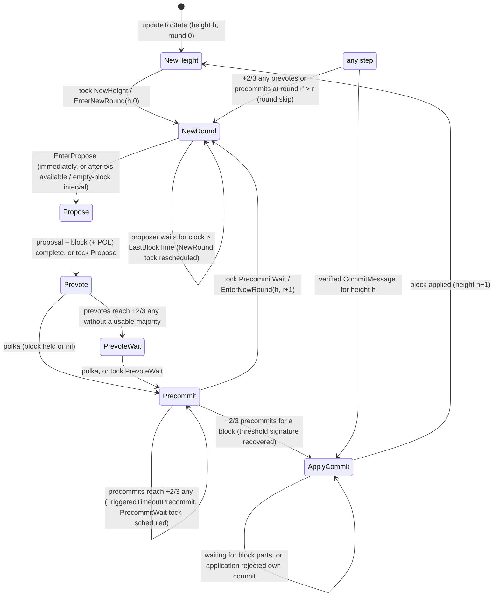

# Tenderdash Consensus Protocol

This document and its companions specify the Tenderdash consensus protocol
**as implemented** in `internal/consensus` and the packages it depends on.
Every non-trivial rule cites the function that implements it. Where the
implementation diverges from the Tendermint algorithm it descends from, the
implementation wins and the divergence is recorded in
[Known issues and discrepancies](./consensus-known-issues.md).

Audience: protocol engineers and auditors. Readers are expected to know the
Tendermint consensus algorithm ([consensus paper](./consensus-paper/README.md))
and the ABCI++ interface ([ABCI++ spec](../abci++/README.md)).

## Documents

| Document | Content |
| ---------- | --------- |
| [Consensus Protocol](./consensus.md) (this page) | Scope, terminology, system model, round state, step state machine, invariants |
| [Primary flow of a height](./consensus-happy-path.md) | The happy path from `NewHeight` to the next `NewHeight`, with the ABCI calls it makes |
| [Transitions and decision rules](./consensus-transitions.md) | Formal transition table: guards, actions and postconditions of every step action; timeout semantics; vote-driven dispatch; prevote, precommit and proposal-validity decision procedures |
| [Alternative flows and edge cases](./consensus-alternative-flows.md) | Missing or invalid proposals, locking, valid-block bookkeeping, round skipping, nil rounds, equivocation, vote extensions, timestamps, empty blocks, non-validators, panics, DoS budgets |
| [Commit handling](./consensus-commit.md) | Commits built from local precommits and commits received from peers: verification, parking, candidates, application of a commit, gossip |
| [Recovery and synchronisation](./consensus-recovery.md) | WAL, crash recovery, ABCI handshake replay, block-sync handover |
| [Known issues and discrepancies](./consensus-known-issues.md) | Behaviour that looks like a bug or diverges from the intended algorithm |

Related specifications that this one links to rather than restates:

- [Proposer selection](./proposer-selection.md) — which validator proposes at `(height, round)`.
- [Signing](./signing.md) — sign bytes, request IDs and double-signing rules for proposals and votes.
- [Write-ahead log](./wal.md) — WAL file layout and replay.
- [Evidence](./evidence.md) — evidence model for misbehaviour.
- [Consensus channel messages](../p2p/messages/consensus.md) — wire format of the messages exchanged.
- [ABCI++ expected behaviour](../abci++/abci++_tmint_expected_behavior.md) — the ABCI++ call sequence from the application's point of view.
- [Proposer-based timestamps](./proposer-based-timestamp/README.md) — the timestamp algorithm the timeliness rules come from.

## Scope

In scope: the consensus state machine of a single node (validator or
full node), the rules that decide what it signs, the interaction with the
application over ABCI++, and the parts of message exchange that change
consensus state. Out of scope: the p2p transport, mempool internals, block
sync and state sync (except their handover to consensus), light clients,
and the DoS-defence design (see `docs/CONSENSUS_DOS_*.md`).

Source of truth: the code at the revision this document was written against
(branch `v1.8-dev`). Citations use `path/file.go` and a function name; line
numbers are omitted because they drift.

## Terminology

| Term | Definition | Source |
| ------ | ------------ | -------- |
| **Height** `h` | Index of the block being decided. `State.LastBlockHeight + 1`, or `InitialHeight` for the first block. | `StateData.updateToState` in `internal/consensus/state_data.go` |
| **Round** `r` | Attempt number within a height, starting at 0. | `RoundState.Round` in `internal/consensus/types/round_state.go` |
| **Step** | Position within a round: one of the `RoundStepType` values listed in [Round steps](#round-steps). | `internal/consensus/types/round_state.go` |
| **Validator set** | The members of the active Dash LLMQ quorum: `ValidatorSet{Validators, QuorumType, QuorumHash, ThresholdPublicKey, VotingPowerThreshold, HasPublicKeys}`. Every validator has voting power `DefaultDashVotingPower = 100`. | `types/validator_set.go` |
| **Validator / observer** | A node whose `PrivValidator` pro-tx-hash is in the validator set is a *validator*; any other node is an *observer*. Observers do not sign and ignore votes (see [Non-validators](./consensus-alternative-flows.md#non-validators-and-signer-problems)). | `StateData.isValidator`, `Reactor.handleVoteMessage` in `internal/consensus/reactor.go` |
| **Commit threshold** `T` | Voting power at or above which a vote set is treated as "+2/3". `T = ValidatorSet.VotingPowerThreshold` when that field is set (`> 0`), otherwise the LLMQ-type threshold `QuorumTypeThresholdVotingPower()` (threshold member count × 100). A configured `T` below the strict floor `⌊2·total/3⌋ + 1` is only **warned** about (`BelowStrictThreshold`). | `ValidatorSet.QuorumVotingThresholdPower`, `ValidatorSet.BelowStrictThreshold` in `types/validator_set.go`; warning logged in `StateData.updateToState` |
| **Recovery threshold** `R` | Voting power whose BLS signature shares suffice to recover the quorum's threshold signature: `QuorumTypeThresholdVotingPower()`. It ignores the `VotingPowerThreshold` override. | `ValidatorSet.QuorumTypeThresholdVotingPower` in `types/validator_set.go` |
| **"+2/3 any"** | A vote set whose total admitted power `≥ T`, regardless of which block ids the votes name. | `VoteSet.HasTwoThirdsAny` in `types/vote_set.go` |
| **"+2/3 majority"** / **maj23** | A vote set whose votes for one block id (possibly nil) reach `T`. For precommit sets the majority is additionally recognised only once the threshold signature over the block has been recovered and verified (see [Threshold recovery](#threshold-recovery)). | `VoteSet.TwoThirdsMajority`, `VoteSet.addVerifiedVote` in `types/vote_set.go` |
| **Polka** | A +2/3 majority of prevotes for one block id (nil included) in one round. | `HeightVoteSet.POLInfo` in `internal/consensus/types/height_vote_set.go` |
| **POLRound** | The round whose polka a proposal claims as justification; `-1` when the proposal claims none. | `types.Proposal.POLRound` |
| **BlockID** | `(Hash, PartSetHeader, StateID)`. Nil block id = all three empty. | `types/block.go`, `types/block_meta.go` |
| **StateID** | Hash of `{AppVersion, Height, AppHash, CoreChainLockedHeight, Time}` of the block header; the app hash is the state **after** executing that block (same-block execution). | `Header.StateID` in `types/block.go` |
| **Commit** | `(Height, Round, BlockID, QuorumHash, ThresholdBlockSignature, ThresholdVoteExtensions)`: a single aggregate BLS threshold signature plus one threshold signature per threshold-recoverable vote extension. There are no per-validator signatures in a commit. | `types.Commit` in `types/block.go` |
| **Locked block / round** | The block the node precommitted most recently and the round it did so; `-1`/nil when none. | `RoundState.LockedRound/LockedBlock` |
| **Valid block / round** | The most recent block (and round) for which the node saw a polka in a round `≥` any previous one. | `RoundState.ValidRound/ValidBlock` |
| **CurrentRoundState** | The application's answer to the latest `PrepareProposal`/`ProcessProposal` for the block held in `ProposalBlock`, tagged with the round it was processed for. | `RoundState.CurrentRoundState`, `RoundState.ProcessedBlockID`; `processedFor` in `internal/consensus/block_executor.go` |
| **Parked commit** | A verified commit for the current height whose block has not yet been assembled (`RoundState.Commit != nil`). | `StateData.adoptCommit` in `internal/consensus/state_data.go` |
| **Timely** | A proposal whose receive time lies within `[ts − Precision, ts + MessageDelay·2^⌊round/10⌋ + Precision]` of its timestamp `ts`. | `checkTimely` in `types/validation.go` |

Throughout, `rs` denotes the node's `RoundState` and `state` the committed
`sm.State` (state as of height `h − 1`).

## System model as enforced by the code

- **Single writer.** `State.receiveRoutine` (`internal/consensus/state.go`) is
  the only goroutine that mutates `RoundState`. It `select`s over three inputs:
  transactions becoming available in the mempool (`txNotifier.TxsAvailable()`),
  messages (`msgInfoQueue.read()`: the node's own proposal/votes on an internal
  queue, peers' messages on per-peer lanes), and timer expiries
  (`timeoutTicker.Chan()`). Go's `select` picks randomly among ready cases, so
  there is **no ordering guarantee** between a timeout and a message that are
  both ready.
- **Actions and guards.** Every transition is an `ActionHandler` registered in
  the `Controller` (`internal/consensus/state_controller.go`) and invoked via
  `Controller.Dispatch`. Each `Enter*` action begins with a staleness guard on
  `(height, round, step)`; a dispatch that fails its guard is a silent no-op.
  Dispatches nest: an action may dispatch further actions before returning.
- **Copy-on-read state.** Handlers work on a `StateData` copy taken from
  `StateDataStore` and persist it with `StateData.Save` /
  `StateDataStore.Update`, which checks an optimistic version counter
  (`StateDataStore.update`). A version mismatch is only logged.
- **Equal voting power.** Every validator has power 100; quorum arithmetic is
  therefore a member count × 100.
- **Threshold signatures.** Validators sign with BLS shares of the quorum key.
  A commit is one recovered threshold signature, verifiable against
  `ValidatorSet.ThresholdPublicKey` alone. See [Signing](./signing.md).
- **Same-block execution.** `Header.AppHash` is the application state after
  executing the block's own transactions; consensus validates it against the
  `ProcessProposal` result before voting (`BlockExecutor.ValidateBlockWithRoundState`
  in `internal/state/execution.go`).
- **Safety assumption.** Safety follows the Tendermint argument only while
  `T ≥ ⌊2·total/3⌋ + 1`. The code does not enforce this: a lower
  `VotingPowerThreshold` (or an LLMQ type with a 50 % threshold) is accepted
  with a warning (`ValidatorSet.BelowStrictThreshold`).
- **Time.** The block timestamp is the proposer's local clock
  (`State.makeBlockTime` in `internal/state/state.go`; genesis time for the
  initial height). Receivers judge timeliness with `SynchronyParams`
  (`Precision` default 505 ms, `MessageDelay` default 12 s,
  `types/params.go`). There is no median/BFT time.

## Round state

`RoundState` (`internal/consensus/types/round_state.go`) holds, per node:

| Field | Meaning |
| ------- | --------- |
| `Height, Round, Step, StartTime` | Position in the protocol; `StartTime` is when round 0 of this height may start (= `CommitTime` of the previous height). |
| `CommitTime, CommitRound` | When and in which round +2/3 precommits for a block were observed locally; `CommitRound = -1` until then. |
| `Validators, LastValidators, ProposerSelector` | Validator set for this height, for the previous height, and the proposer-selection strategy. |
| `Proposal, ProposalReceiveTime, ProposalBlock, ProposalBlockParts` | The accepted proposal of the current round, when it was received, and the block being assembled from parts. |
| `LockedRound, LockedBlock, LockedBlockParts` | Lock. |
| `ValidRound, ValidBlock, ValidBlockParts, ValidBlockRecvTime` | Valid block. `ValidBlockRecvTime` is the receive time used when re-proposing. |
| `Commit` | Parked commit (see [Commit handling](./consensus-commit.md)). |
| `Votes` | `HeightVoteSet`: prevote and precommit `VoteSet`s for rounds `0..Round+1` plus up to two catch-up rounds per validator. |
| `LastCommit` | The commit of height `h − 1`, included in the next proposed block. There is no `LastCommit` vote set: late precommits for `h − 1` are dropped. |
| `TriggeredTimeoutPrecommit` | Whether the precommit-wait timeout was already scheduled for this round. |
| `ProposeNextBlockImmediately` | Hint from `ResponseFinalizeBlock.propose_next_block_immediately` of the previous height; consumed once, not persisted. |
| `CurrentRoundState, ProcessedBlockID` | Latest application result for `ProposalBlock` (see Terminology). |

`StateData.updateToState` re-initialises `Height`, `Validators`,
`LastValidators`, `LastCommit`, `ProposerSelector` and `StartTime` for the
new height and resets every proposal, lock, valid-block, commit, vote and
flag field. `CurrentRoundState`/`ProcessedBlockID` are left untouched; they
are compared against the new height's block by `processedFor`. Within a
height `LockedRound/Block` and `ValidRound/Block` are never reset; `Commit`
is cleared only when a parked commit is rejected (`selectParkedCommit`,
`TryAddCommitAction.Execute`).

## Round steps

`RoundStepType` is an ordered enum (`internal/consensus/types/round_state.go`):

| Value | Step | Entered by |
| ------- | ------ | ------------ |
| 1 | `NewHeight` | `StateData.updateToState` (after a block is applied, after block sync, at start) |
| 2 | `NewRound` | `EnterNewRoundAction` |
| 3 | `Propose` | `EnterProposeAction` |
| 4 | `Prevote` | `EnterPrevoteAction` |
| 5 | `PrevoteWait` | `EnterPrevoteWaitAction` |
| 6 | `Precommit` | `EnterPrecommitAction` |
| 7 | `PrecommitWait` | **never assigned** — `EnterPrecommitWaitAction` sets `TriggeredTimeoutPrecommit` but leaves `Step` at `Precommit` (see [Known issues](./consensus-known-issues.md#precommitwait-step-is-never-entered)). The value is still used as the timeout's step and in peer-state comparisons. |
| 8 | `ApplyCommit` | `EnterCommitAction`, `AddCommitAction` |

The precise guards of every arrow are in
[Transitions and decision rules](./consensus-transitions.md).

## Invariants

The following hold by construction of the code; each names the function that
preserves it.

1. **Lock monotonicity.** `LockedRound` only increases within a height. It is
   written by `StateData.updateLockedBlock` (first lock) and by the relock
   branch of `EnterPrecommitAction.Execute` (`LockedRound = round`), both at
   the current round, and reset to `-1` only by `StateData.updateToState`.
   There is no unlock: a nil polka at a later round does not clear the lock
   (`TestStateLock_POLDoesNotUnlock` in `internal/consensus/state_test.go`).
2. **Lock implies polka.** A node locks on block `B` at round `r` only after
   `Prevotes(r).TwoThirdsMajority() == B` and only when `B` is this round's
   proposal block (`EnterPrecommitAction.Execute`).
3. **Precommit implies processed.** A non-nil precommit for `B` at round `r`
   is signed only after `ProcessProposal(B, r)` succeeded and
   `ValidateBlockWithRoundState` passed for this round
   (`blockExecutor.mustEnsureProcess`, `blockExecutor.mustValidate` called from
   `EnterPrecommitAction.Execute`). Consequently `ExtendVote` is asked for the
   round the application processed last.
4. **Valid-round monotonicity.** `ValidRound` is set to the current round by
   `StateData.updateValidBlock`; callers only invoke it when
   `ValidRound < Round` (`addVoteUpdateValidBlockMw`, `ProposalCompletedAction`)
   or from the lock branch at the current round.
5. **One proposal per round.** `Proposaler.Set` ignores any proposal once
   `rs.Proposal != nil`; the first proposal that verifies wins.
6. **Application result currency.** `CurrentRoundState` describes the
   application's latest successful `ProcessProposal`/`PrepareProposal` for
   `ProposalBlock`; a result for another round or block is never reused
   (`blockExecutor.ensureProcess`, `processedFor`, `ensureOwnRound`).
7. **Commit = recovered threshold signature.** `VoteSet.MakeCommit` panics
   unless `maj23` is set and `thresholdBlockSig` was recovered; for precommit
   sets `maj23` is set only after recovery and verification succeed
   (`VoteSet.addVerifiedVote`, `VoteSet.recoverThresholdSignsAndVerify`).
8. **Commit matches held block.** A commit is applied only when its
   `BlockID` (hash, part-set header **and** state id) equals that of the block
   held (`verifyCommitBlock` in `internal/consensus/state_try_add_commit.go`,
   called by both `prepareCommitForApply` and `ApplyCommitAction.Execute`).
9. **WAL before signature.** The WAL is flushed and fsynced before the node
   signs a proposal or a vote (`EnterProposeAction.Execute`,
   `voteSigner.signVote`), and `EndHeightMessage` is fsynced after the block is
   saved and before `FinalizeBlock` (`ApplyCommitAction.Execute`).
10. **Height votes only.** Votes and commits for any height other than
    `rs.Height` are dropped (`addVoteValidateVoteMw`,
    `StateData.readyToApplyCommit`).

## Threshold recovery

`VoteSet.addVerifiedVote` (`types/vote_set.go`) sets `maj23` for a block id
when the power behind it reaches `T`. For **precommit** sets it then calls
`recoverThresholdSignsAndVerify`:

1. With a single validator the vote's own signatures are used.
2. Otherwise `canonicalVoteExtensionGroup` picks the group of votes that carry
   an identical ordered vector of threshold-recoverable extensions and whose
   power is `≥ R` (ties broken by lexicographic order of the group identity,
   empty vector first).
3. `NewSignsRecoverer(...).Recover()` recovers the block threshold signature
   from all votes for the block and the extension threshold signatures from the
   canonical group's votes.
4. The recovered signatures are verified against
   `ValidatorSet.ThresholdPublicKey` over the canonical vote's sign data.

If any step fails, `maj23` and the recovered signatures are rolled back and
the attempt is repeated when a later vote makes the block cross `T` again or
makes an extension group cross `R`. Externally, therefore, a precommit
majority is observable only once a verifiable commit can be built from it.
Prevote sets set `maj23` at `T` without recovery.

## Timeouts and consensus parameters

Timeouts come from `ConsensusParams.Timeout` of the committed state (changes
proposed in block `h` apply from `h + 1`, `CurrentRoundState` in
`internal/state/current_round_state.go`), with zero fields replaced by defaults
(`TimeoutParams.TimeoutParamsOrDefaults`, `types/params.go`):

| Parameter | Default | Used for |
| ----------- | --------- | ---------- |
| `Propose` | 3000 ms | `proposeTimeout(r) = Propose + ProposeDelta·r` |
| `ProposeDelta` | 500 ms | |
| `Vote` | 1000 ms | `voteTimeout(r) = Vote + VoteDelta·r` (prevote wait, precommit wait, and the signing deadline of a non-nil precommit) |
| `VoteDelta` | 500 ms | |
| `Synchrony.Precision` | 505 ms | Timeliness window |
| `Synchrony.MessageDelay` | 12 s | Timeliness window; doubled every 10 rounds |

Per-node `Unsafe*TimeoutOverride` settings in `config.ConsensusConfig` replace
the corresponding parameter locally (`StateData.proposeTimeout`,
`StateData.voteTimeout`); they desynchronise timing between nodes and are not
part of the protocol. There is **no commit timeout**: `StartTime` of the next
height equals `CommitTime`, so round 0 starts as soon as the block is applied
(`StateData.updateToState`, `roundScheduler.ScheduleRound0`). The
`unsafe-commit-timeout-override` / `unsafe-bypass-commit-timeout-override`
settings are deprecated no-ops that only produce a warning
(`config.ConsensusConfig`).

Escalation with the round is linear, not exponential.
